# Awesome Translation Tools

> Ein kuratiertes Verzeichnis von Übersetzungswerkzeugen und Arbeitsabläufen für Reisen, Weblektüre, formatierte Dokumente, akademische Forschung, quelloffene lokale Engines und Entwickler-Pipelines.

[English](README.md) | [简体中文](README.zh-CN.md) | [日本語](README.ja.md) | [한국어](README.ko.md) | [Deutsch](README.de.md) | [Français](README.fr.md) | [Español](README.es.md) | [Português (Brasil)](README.pt-BR.md) | [Italiano](README.it.md) | [Русский](README.ru.md) | [العربية](README.ar.md) | [हिन्दी](README.hi.md) | [Bahasa Indonesia](README.id.md) | [Türkçe](README.tr.md)

---

Übersetzungsaufgaben unterscheiden sich je nach Kontext grundlegend: das Entziffern eines Straßenschilds oder einer Speisekarte auf dem Smartphone, das Lesen fremdsprachiger Dokumentationen im Browser, das Übersetzen komplexer Präsentationen und Verträge ohne Zerstörung des Layouts, das Bewahren mathematischer Formeln in wissenschaftlichen Arbeiten, das Durchführen privater Batch-Übersetzungen im Terminal oder das Verfolgen von Videostreams ohne Untertitel.

Wir sind das **[Equalang](https://equalang.com/?utm_source=github)**-Team. Dieses Verzeichnis bietet einen praxisorientierten, aufgabenspezifischen Katalog etablierter Übersetzungsprodukte und Open-Source-Projekte. Für jedes Werkzeug fassen wir dokumentierte Funktionen, Einstiegspunkte, Bereitstellungsmodi und betriebliche Einschränkungen zusammen, damit Sie die passende Lösung für Ihren Arbeitsablauf finden.

---

## Inhaltsverzeichnis

- [1. Unterwegs auf Reisen & gesprochener Austausch: Multimodale und gesprochene Eingaben](#1-on-the-go-travel--spoken-exchange-multi-modal-and-spoken-inputs)
  - [Google Translate](#google-translate)
  - [Apple Translate](#apple-translate)
  - [Microsoft Translator](#microsoft-translator)
  - [Papago](#papago)
  - [iTranslate](#itranslate)
- [2. Kontextbezogenes Lesen im Web & Sprachenlernen: Lesen ohne Seitenwechsel](#2-in-context-web-reading--language-learning-reading-without-leaving-the-page)
  - [Immersive Translate](#immersive-translate)
  - [Mate Translate](#mate-translate)
  - [Reverso](#reverso)
  - [Yandex Translate](#yandex-translate)
- [3. Komplexe Dokumentenlayouts & Unternehmens-Workflows: Formate und Ressourcen bewahren](#3-complex-document-layouts--enterprise-workflows-preserving-formats-and-assets)
  - [DeepL](#deepl)
  - [O.Translator](#otranslator)
  - [SimplifyAI](#simplifyai)
  - [Lingvanex](#lingvanex)
  - [SYSTRAN](#systran)
- [4. Akademisches Schreiben, Verfeinerung & Human-in-the-Loop-Zusammenarbeit: Den Text feinschleifen](#4-academic-writing-refinement--human-in-the-loop-collaboration-polishing-the-output)
  - [Youdao Translate (NetEase Youdao)](#youdao-translate-netease-youdao)
  - [Baidu Translate](#baidu-translate)
  - [TranSmart (Tencent Interactive Translation)](#transmart-tencent-interactive-translation)
  - [LingoCloud (Caiyun Xiaoyi)](#lingocloud-caiyun-xiaoyi)
  - [QuillBot Translate](#quillbot-translate)
- [5. Open-Source-Ökosystem: Lokale Engines, APIs, Desktop-Clients & wissenschaftliche PDF-Pipelines](#5-open-source-ecosystem-local-engines-apis-desktop-clients--scientific-pdf-pipelines)
  - [5.1 Wissenschaftliche & akademische PDF-Pipelines](#51-scientific--academic-pdf-pipelines)
    - [PDFMathTranslate (pdf2zh)](#pdfmathtranslate-pdf2zh)
    - [BabelDOC](#babeldoc)
  - [5.2 Selbst hostbare Engines & APIs](#52-self-hostable-engines--apis)
    - [LibreTranslate](#libretranslate)
    - [Argos Translate](#argos-translate)
  - [5.3 Desktop- & Terminal-Frontends](#53-desktop--terminal-frontends)
    - [Pot (pot-desktop)](#pot-pot-desktop)
    - [Translate Shell](#translate-shell)
- [6. Verknüpfte End-to-End-Workflows:](#6-connected-end-to-end-workflows-equalang) [Equalang](https://equalang.com/?utm_source=github)
  - [1. Vollständige Dokumentenübersetzung unter Beibehaltung des Layouts](#1-whole-file-document-translation-with-layout-preservation)
  - [2. Lesen im Browser & Untertitelgenerierung](#2-in-browser-reading--subtitle-generation)
  - [3. Installationsfreie gesprochene Kommunikation & Vor-Ort-Austausch](#3-installation-free-spoken-communication--on-site-exchange)
  - [4. Integration für KI-Agenten und Entwickler](#4-integration-for-ai-agents-and-developers)
- [7. Aufgabenbasierter Entscheidungsleitfaden](#7-task-based-decision-guide)
- [8. Verzeichnisprinzipien & Prüfkriterien](#8-directory-principles--verification-criteria)
- [9. Quellen](#9-sources)

---

## 1. Unterwegs auf Reisen & gesprochener Austausch: Multimodale und gesprochene Eingaben

Reisen und Außeneinsätze erfordern eine schnelle Aktivierung, verlässliche multimodale Erkennung und Offline-Bereitschaft bei eingeschränkter Netzwerkverbindung.

### Google Translate
[Google Übersetzer auf Mobilgeräten](https://support.google.com/translate) integriert Sofort-Kamera-OCR, Foto-Importe, Handschrifteingabe und einen geteilten Bildschirm für persönliche Gespräche von Angesicht zu Angesicht. Reisende können Sprachpakete vorab herunterladen, um Texte und Kameraaufnahmen offline zu übersetzen. Die gesprochene Konversationsübersetzung bietet mehrere Anzeigelayouts, wenngleich das Dolmetschen von Live-Gesprächen im Offline-Betrieb auf bestimmte Pixel-Geräte und ausgewählte Sprachpaare beschränkt ist.

In Desktop-Browsern bietet Google Übersetzer ein spezielles [Dokumentenübersetzungs-Portal](https://support.google.com/translate/answer/2534559?co=GENIE.Platform%3DDesktop&hl=en), das DOCX-, PDF-, PPTX- und XLSX-Dateien verarbeitet. Dieses Desktop-Werkzeug ist für digitale Dateien konzipiert; gescannte PDF-Seiten, die reine Rastergrafiken enthalten, bleiben in der heruntergeladenen Datei ohne OCR-Übersetzung erhalten.

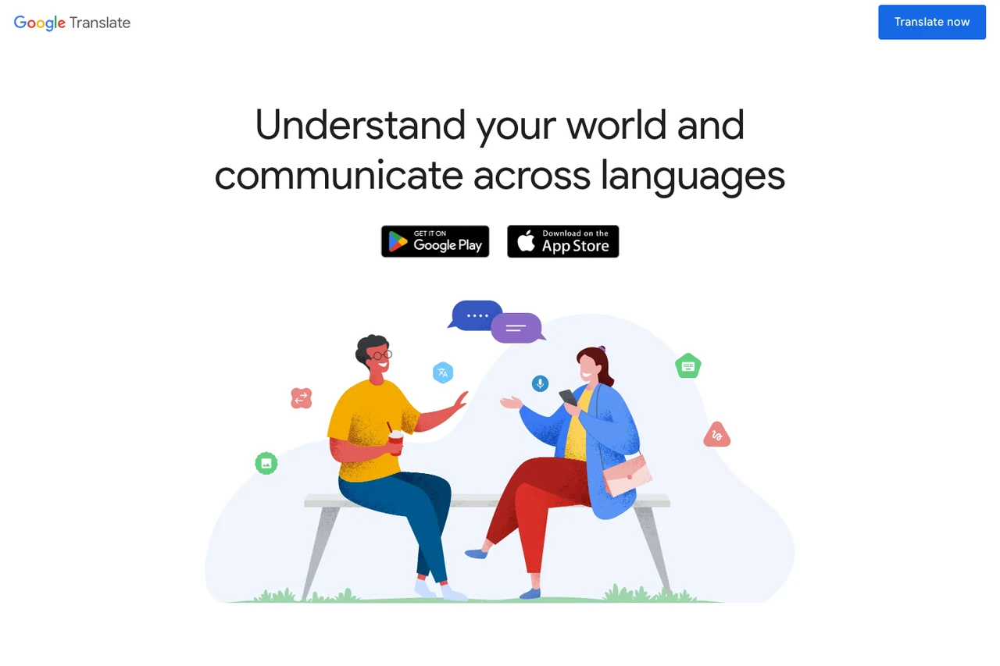 Offizielle Google Übersetzer Produktübersichtsseite und Download-Bereich für Mobil-Apps

### Apple Translate
Für Nutzer von iPhone und iPad erfordert die systemintegrierte [Apple Übersetzen App](https://support.apple.com/en-gb/guide/iphone/iphd74cb450f/ios) keine separate Installation. Sie unterstützt getippten Text, Spracheingabe, Texterkennung über die Kamera sowie einen geteilten Bildschirm für persönliche Unterhaltungen. Der Konversationsmodus erkennt automatisch, welche Sprache gesprochen wird, sodass das Mikrofon nicht manuell zwischen den Gesprächspartnern umgeschaltet werden muss. Heruntergeladene Sprachpakete ermöglichen Textabfragen auf dem Gerät ohne Mobilfunkverbindung.

Innerhalb des Apple-Betriebssystems erstrecken sich [Live-Übersetzungsfunktionen](https://support.apple.com/en-us/123720) auch auf Nachrichten, Telefon und FaceTime. Die Live-Übersetzung von Telefongesprächen ist Teil von Apple Intelligence, erfordert kompatible Hardware sowie Systemversionen und unterliegt regionalen Verfügbarkeitsbeschränkungen (beispielsweise unterstützen auf dem chinesischen Festland erworbene Geräte diese erweiterten Anruffunktionen von Apple Intelligence derzeit nicht).

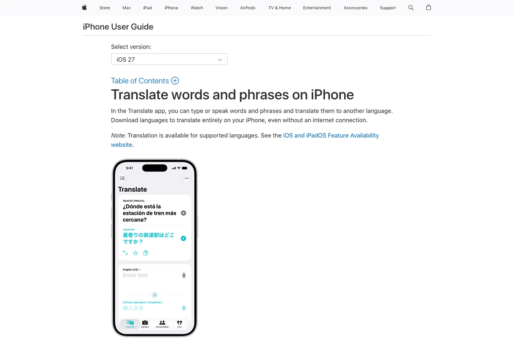 Apple Support-Anleitungsseite zum Übersetzen von Wörtern und Sätzen auf dem iPhone

### Microsoft Translator
Die mobile App von [Microsoft Translator](https://www.microsoft.com/en-us/translator/apps/features/) zeichnet sich durch ihre [geräteübergreifende Konversationsfunktion](https://www.microsoft.com/en-us/translator/help/multi-device-conversation/) aus. Ein Gastgeber startet eine Sitzung auf dem Smartphone, und Teilnehmer treten über die Mobil-App oder einen beliebigen Desktop-Webbrowser bei, indem sie einen QR-Code scannen oder einen Code eingeben. Jeder Teilnehmer erhält eine Live-Transkription und -Übersetzung in seiner ausgewählten Sprache. Der Präsentationsmodus hält das Mikrofon des Gastgebers geöffnet, während die Zuhörer stummgeschaltet bleiben – nützlich für Führungen und Vorträge.

Die App enthält zudem herunterladbare Sprachführer und Offline-Fotoübersetzung für häufige Reiseabfragen. Die Endnutzer-App unterstützt weder das direkte Übersetzen externer Filme noch von Videodateien oder Medienaufnahmen, und geräteübergreifende Sprachsitzungen setzen eine aktive Internetverbindung voraus.

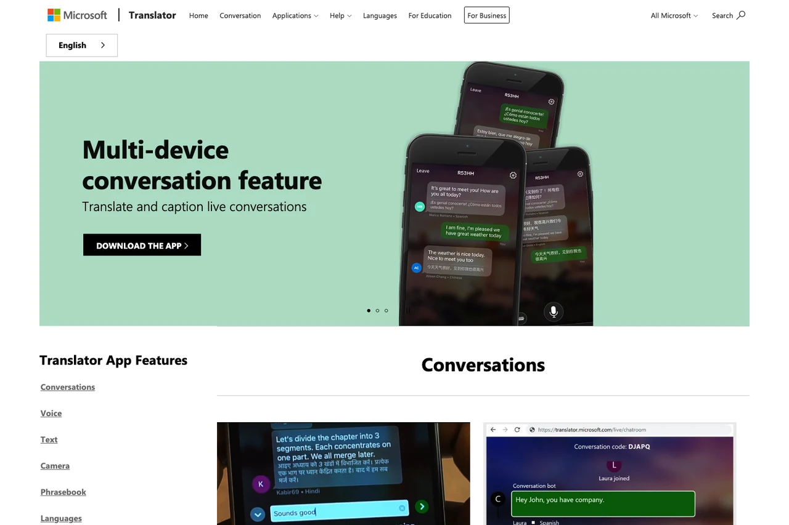 Microsoft Translator Funktionsseite mit Hervorhebung der geräteübergreifenden Konversationsfunktion

### Papago
Entwickelt von NAVER in Südkorea, bietet [Papago](https://papago.naver.com/) praktische Funktionen für ostasiatische Sprachen wie Koreanisch, Englisch, Japanisch und Chinesisch. Auf Mobilgeräten bietet die [Anwendung](https://play.google.com/store/apps/details?hl=en-US&id=com.naver.labs.translator) Dialoge von Angesicht zu Angesicht, einen Edu-Modus zum Erstellen von Lernnotizen aus gedrucktem Text und das schwebende Fenster Papago Mini, was es bei Restaurantbesuchen, Nahverkehrsfragen und beim Lernen in Korea praktisch macht.

Bei der Webseitenübersetzung unterscheiden sich die verfügbaren Einstiegspunkte je nach Plattform: NAVER hat das eigenständige Website-Übersetzungswerkzeug im Desktop-Webportal eingestellt und verweist PC-Nutzer auf den Papago-gestützten [Whale-Browser](https://whale.naver.com/), während die [Papago-Mobil-App](https://help.naver.com/service/16448/contents/15637?lang=ko&osType=MOBILE) weiterhin eine Webseiten-Übersetzungsoption in ihrem Seitenmenü bereithält. Wenn Sprachpakete auf kompatiblen Geräten heruntergeladen werden, die die Systemvoraussetzungen erfüllen (wie in der [Offline-Dokumentation von NAVER](https://help.naver.com/service/16448/contents/10663?osType=MOBILE) beschrieben: mindestens 4 GB RAM sowie Android 14+ mit dedizierten Sprachpaketen für Audio), unterstützt die Offline-Übersetzung Text und Sprache zwischen Koreanisch, Englisch, Japanisch und vereinfachtem Chinesisch. Beachten Sie, dass der Offline-Modus weder Foto-OCR, den Konversationsmodus, Webseiten noch Dokumentdateien abdeckt.

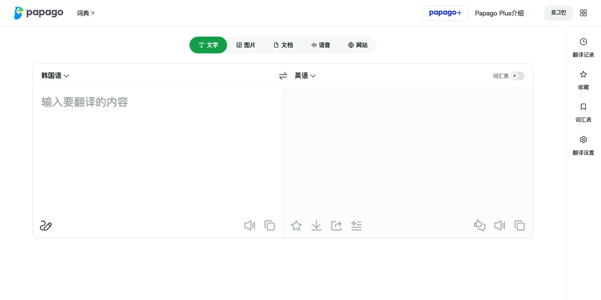 Web-Übersetzungsarbeitsbereich von NAVER Papago

### iTranslate
[iTranslate](https://itranslate.com/) ist bekannt für seine integrierte [Tastatur-Erweiterung](https://itranslate.com/features/keyboard-translations/index.html). Beim Verfassen von Nachrichten in WhatsApp, iMessage oder E-Mails können Nutzer Texte direkt innerhalb der Tastaturoberfläche übersetzen, wodurch der ständige Wechsel zwischen separaten Apps entfällt.

Über seine [Offline-Werkzeuge](https://itranslate.com/features/offline-translations/index.html) stellt es zudem herunterladbare Pakete für gängige Reiseausdrücke und grundlegende Phrasenbücher bereit, was das Wiederholen wichtiger Ausdrücke vor Reiseantritt erleichtert. Die Verfügbarkeit der Funktionen variiert zwischen den Betriebssystemen, und die Offline-Sprachfunktionen sind auf eine ausgewählte Liste wichtiger Sprachen beschränkt.

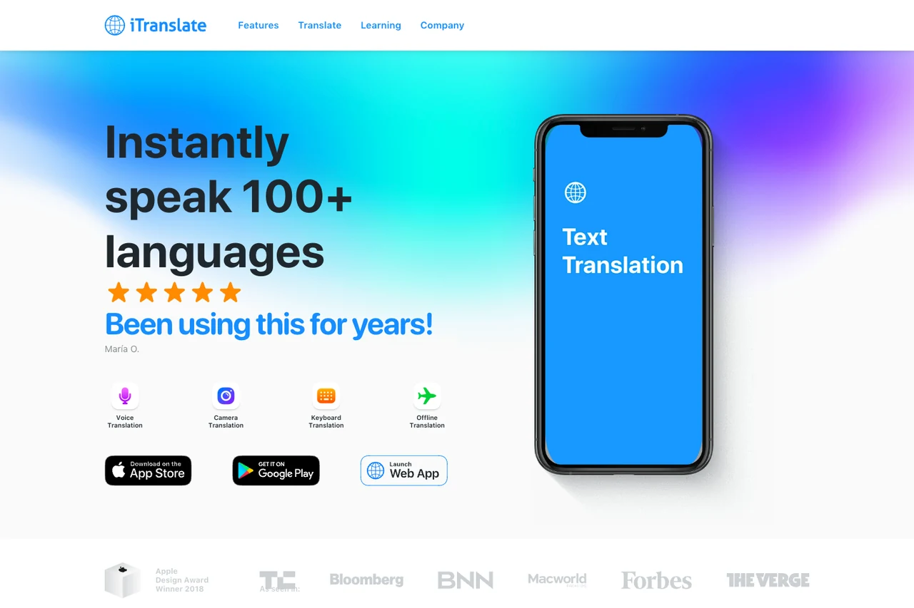 iTranslate-Startseite mit Oberflächenvorschauen der mobilen Anwendung

---

## 2. Kontextbezogenes Lesen im Web & Sprachenlernen: Lesen ohne Seitenwechsel

Beim Durcharbeiten ausländischer Artikel oder Dokumentationen unterbricht das Hin- und Herspringen zu einem externen Übersetzungs-Tab die Konzentration. Kontextbezogene Werkzeuge binden Übersetzungen direkt in die aktive Leseumgebung ein.

### Immersive Translate
[Immersive Translate](https://immersivetranslate.com/) ist eine Browser-Erweiterung, die übersetzte Absätze direkt unter dem ursprünglichen Webtext einfügt und so ein übersichtliches zweisprachiges Layout präsentiert. Sie unterstützt außerdem das Erstellen zweisprachiger EPUB-E-Books, das Anzeigen von PDFs und das Übersetzen von Texten in Browser-Eingabefeldern.

Im Multimediabereich übersetzt Immersive Translate vorhandene Untertitelspuren auf Plattformen wie YouTube und Netflix. Darüber hinaus bietet die [KI-Videoübersetzung](https://immersivetranslate.com/video/ai-video-translator/) eine Spracherkennung, um zweisprachige Untertitel für Videos ohne Untertitel auf unterstützten Plattformen wie YouTube zu erzeugen, ergänzt durch ein dediziertes [Portal für YouTube-Live-Übersetzungen](https://livetranslate.immersivetranslate.com/zh-CN). Die Untertitelgenerierung aus Tonspuren ohne Untertitel hängt von der Browserkompatibilität, der Tonklarheit und den Streaming-Bedingungen der Plattform ab.

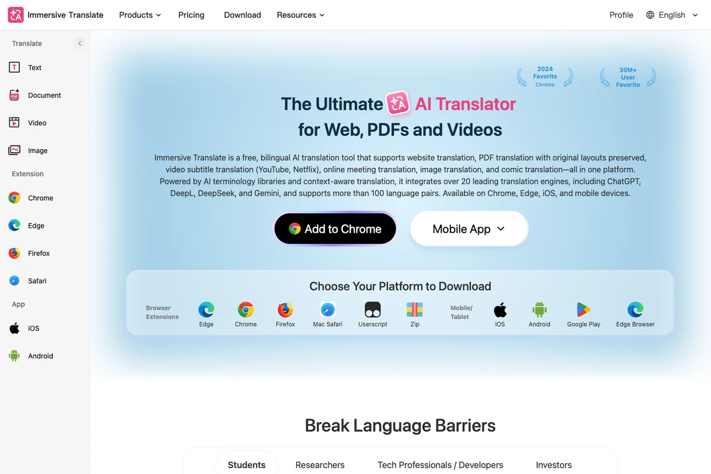 Startseite von Immersive Translate und Download-Portal für Browser-Erweiterungen

### Mate Translate
[Mate Translate](https://matetranslate.com/en) ist auf macOS, iOS und gängige Desktop-Browser zugeschnitten. Beim Surfen zeigt ein Doppelklick auf ein beliebiges Wort eine sofortige Pop-up-Definition an, das Markieren von Text öffnet schnelle Kontextübersetzungen, die Ganzseitenübersetzung wechselt zwischen Original- und Übersetzungsansicht, und ein dauerhaftes Dienstprogramm für die Mac-Menüleiste steht bereit.

Für Sprachenlerner ermöglicht Mate das Anklicken von Wörtern auf Webseiten oder in Netflix-Untertiteln, um diese in einem benutzerdefinierten Phrasenbuch zu speichern, das eigene Kategorisierungen und den CSV-Export zur externen Wiederholung unterstützt. In Desktop-Browsern wie Chrome erlaubt die Erweiterung zudem das Auswählen von Text im integrierten PDF-Betrachter, um Übersetzungen direkt auszulösen.

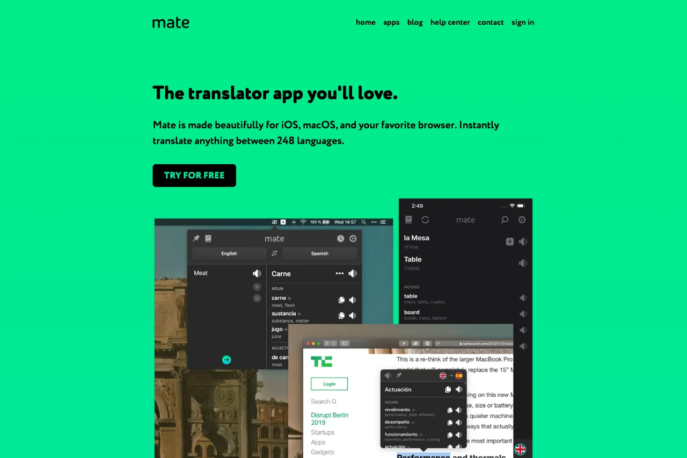 Startseite von Mate Translate mit plattformübergreifenden Oberflächenvorschauen

### Reverso
Für Autoren und Lernende, die den natürlichen Sprachgebrauch überprüfen möchten, bietet [Reverso Context](https://context.reverso.net/translation/about) zweisprachige Satzpaare aus Filmen, internationalen Publikationen und mehrsprachigen Websites, ergänzt durch Verbtabellen und Synonymempfehlungen. Da Beispielsätze aus öffentlichen mehrsprachigen Korpora stammen, sollten Nutzer die Angemessenheit des Kontexts für sensible oder formelle Entwürfe prüfen.

Das Dokumentenportal [Reverso Documents](https://www.reverso.net/documents/en) verarbeitet PDF-, Word-, PowerPoint-, Excel- und ausgewählte Lokalisierungsdateien. Es stellt eine browserbasierte Segment-für-Segment-Korrekturoberfläche bereit, auf der Teams Änderungen gemeinsam vornehmen können, bevor die fertige Datei heruntergeladen wird.

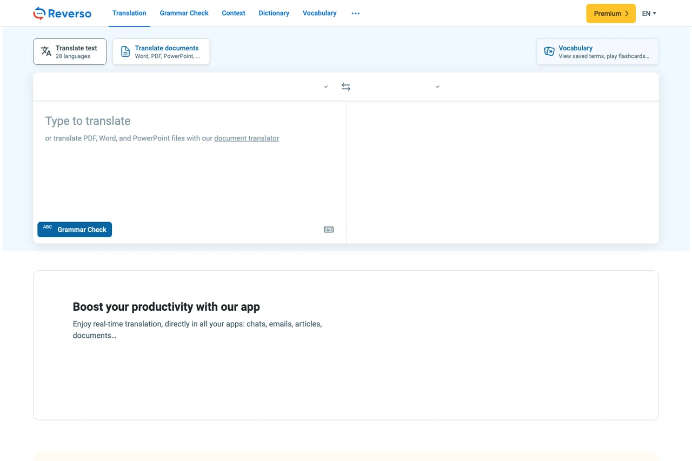 Reverso Web-Übersetzungsoberfläche und Navigationsleiste

### Yandex Translate
Das [Webportal von Yandex Translate](https://yandex.com/support/translate-desktop/en/) und die mobilen Apps verarbeiten Texte, Bilder, Websites und Dokumente. Sein Android-Client enthält ein ausführliches Wörterbuch, das Lautschriften, Definitionen, Synonyme und morphologische Beugungsformen für unterstützte Sprachen anzeigt.

Auf Mobilgeräten verfügt die Android-App über ein vorinstalliertes Englisch-Russisch-[Offline-Wörterbuch](https://yandex.ru/support/translate-app-android/en/offline-mobile), während zusätzliche Sprachpakete für die Offline-Übersetzung von getipptem Text heruntergeladen werden können. Die Desktop-Oberfläche unterstützt standardmäßige Office- und PDF-Uploads. Zu beachten ist die Unterscheidung zwischen Yandex Translate als eigenständigem Dienst und dem Yandex Browser, der proprietäre automatische Video-Voiceover-Funktionen beherbergt.

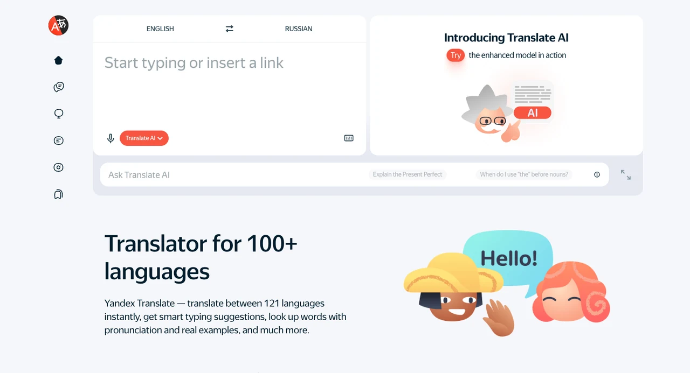 Eingabeoberfläche und Seitennavigation von Yandex Translate

---

## 3. Komplexe Dokumentenlayouts & Unternehmens-Workflows: Formate und Ressourcen bewahren

Bei Präsentationen, Lieferantenverträgen oder technischen Handbüchern erfordern verzerrte Layouts erhebliche manuelle Nacharbeit. Diese Werkzeuge priorisieren die Beibehaltung des Layouts, die Terminologiekontrolle und die Wiederverwendung von Ressourcen.

### DeepL
[DeepL Übersetzer](https://www.deepl.com/en/features) bietet detaillierte Konfigurationsoptionen für Text- und Dokumenten-Workflows. Nutzer können [Glossare](https://www.deepl.com/en/features/glossary) anlegen, um bevorzugte unternehmens- oder fachspezifische Übersetzungen durchzusetzen, und in unterstützten Sprachen zwischen formeller und informeller Anrede (Du/Sie) umschalten.

Der [Dokumentenübersetzungsdienst](https://www.deepl.com/en/features/document-translation) akzeptiert Word-, PDF-, PPT-, Excel-, HTML- und SRT-Dateien (wobei der Formatzugriff je nach Kontotyp variiert). Das Produktökosystem umfasst zudem DeepL Write zum Feinschleifen von Texten, [DeepL Voice for Online Meetings](https://support.deepl.com/hc/en-us/articles/16810100955676-About-DeepL-Voice-for-Online-Meetings) für Echtzeit-Untertitel in Teams und Zoom (erfordert Voice-Lizenzierung und Gastgeber-Berechtigungen) sowie einen offiziellen Model Context Protocol (MCP)-Leitfaden für KI-Agenten.

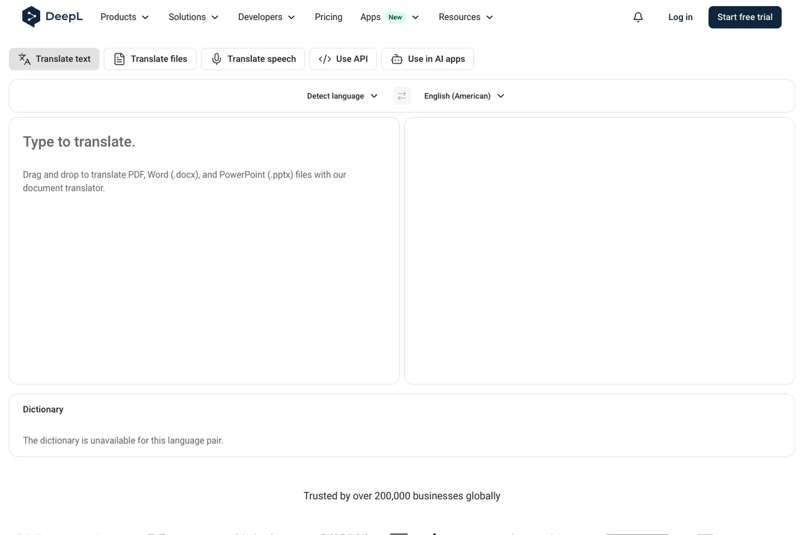 Web-Übersetzungsoberfläche von DeepL

### O.Translator
[O.Translator](https://otranslator.com/en/product-info) konzentriert sich auf die layoutgetreue Dokumentenübersetzung. Neben PDF, Word, PPT und Excel unterstützt es Verlags- und Lokalisierungsformate wie EPUB-E-Books, InDesign (IDML), Illustrator (AI), OpenDocument, Untertiteldateien (SRT/ASS) und Comic-Archive (CBZ/CBR), mit integrierter OCR für gescannte Seiten. Die Layoutgenauigkeit hängt von der Schriftarteinbettung und der Textausdehnung in der Zielsprache ab.

Vor dem Übersetzen einer gesamten Datei ermöglicht O.Translator den Nutzern die Prüfung einer teilweisen Layoutvorschau. Es unterstützt den Import von Glossaren über XLSX oder TBX und stellt eine [Entwickler-API](https://www.otranslator.com/en/developer/v1) bereit. Seine Medienoption ist für die Transkription hochgeladener Audio- und Videodateien in Untertiteldateien ausgelegt, nicht für die Echtzeit-Übersetzung von Browser-Streams.

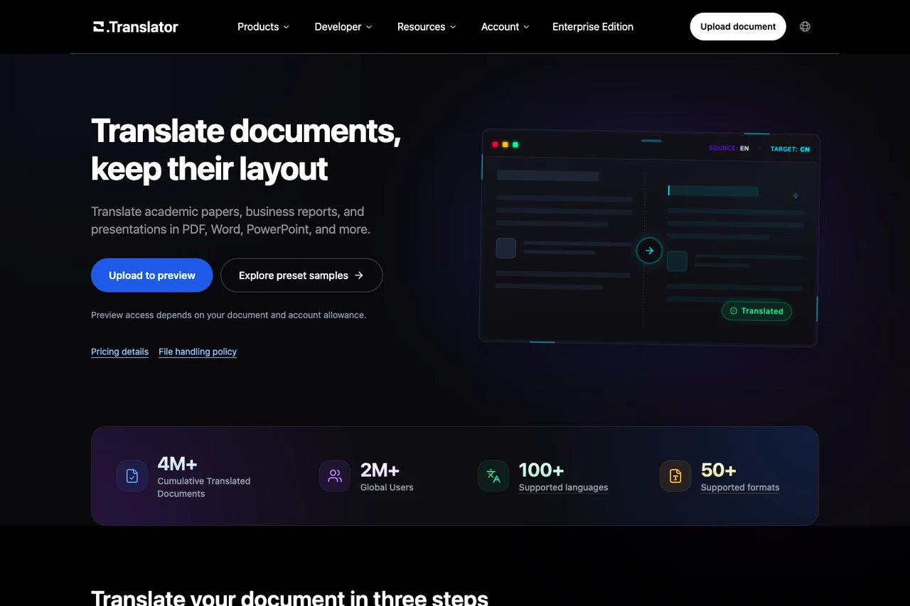 Startseite von O.Translator und Bereich für den Dokumenten-Upload

### SimplifyAI
SimplifyAI betreibt zwei unterschiedliche Websites: eine KI-gestützte [Workbench für komplexe Dokumente](https://simplifyai.cn/zh/translate) (simplifyai.cn/zh) und ein [allgemeines Dokumentenübersetzungs-Portal](https://translate.simplifyai.cn/) (translate.simplifyai.cn).

Innerhalb der Workbench kann das System vor der Übersetzung hochfrequente Fachbegriffe zur Prüfung durch den Nutzer aus Word-, PPTX-, InDesign-, PDF- und EPUB-Dateien extrahieren. Die Workbench bietet außerdem KI-Editierung für Word und InDesign (mit Unterstützung für native Word-Änderungsverfolgung), zweisprachigen Datenexport (Excel/XLIFF), strukturierte Markdown/JSON-Extraktion sowie visuelle Prüfungen auf Textüberlauf und Schriftartenlayout, wodurch sie sich gut für Druckvorstufe und Lokalisierung von Designressourcen eignet. Für unkomplizierte alltägliche Dateiübersetzungen bietet das allgemeine Übersetzungsportal einen einfacheren, direkten Ablauf.

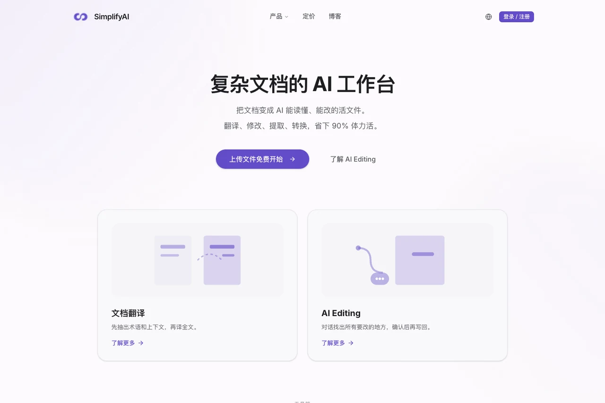 Startseite von SimplifyAI mit Darstellung der Workbench für komplexe Dokumente und Modulen

### Lingvanex
[Lingvanex](https://lingvanex.com/) bietet Desktop-, Mobil- und Browser-Clients für Windows und macOS. Sein [Windows Desktop Translator](https://lingvanex.com/products/windows-translator/) unterstützt systemweite Tastenkombinationen (wie zweimaliges Drücken von Strg+C auf markiertem Text) und ermöglicht nach dem Herunterladen von Sprachpaketen die Offline-Text- sowie lokale DOCX/ODT-Dateiübersetzung.

Über Endanwender-Anwendungen hinaus bietet Lingvanex herunterladbare [Secure Translation Software](https://lingvanex.com/products/secure-translation-software/) als Desktop-Software für den sicheren Offline-Einsatz in Unternehmen sowie separate On-Premise-Lösungen für maschinelle Übersetzung in privaten Netzwerkumgebungen.

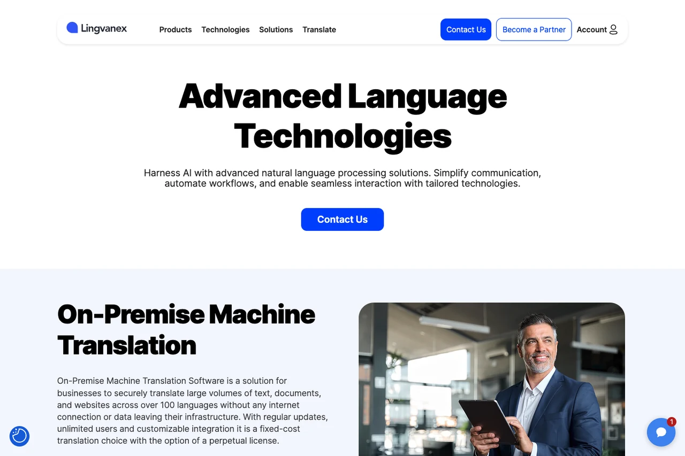 Startseite von Lingvanex mit Unternehmensübersetzung und On-Premise-Lösungen

### SYSTRAN
SYSTRAN richtet sich an Lokalisierungsanforderungen von Unternehmen und Institutionen. Sein Cloud-Dienst [SYSTRAN Translate Pro](https://www.systransoft.com/translation-products/translate-pro/) ist sofort für Word-, PowerPoint-, Excel- und PDF-Dateien verfügbar und bietet vorkonfigurierte Fachmodelle für rechtliche, finanzielle und industrielle Dokumentationen neben benutzerdefinierten Glossaren und Translation Memorys (TM).

Für Organisationen mit Anforderungen an Datenhoheit bietet SYSTRAN den [Translate Server](https://www.systransoft.com/translation-products/translate-server/) zur On-Premise-Bereitstellung hinter Unternehmens-Firewalls, dedizierte Private-Cloud-Umgebungen sowie Batch-[APIs](https://www.systransoft.com/translation-products/translate-api/) für Dokumenten-Pipelines.

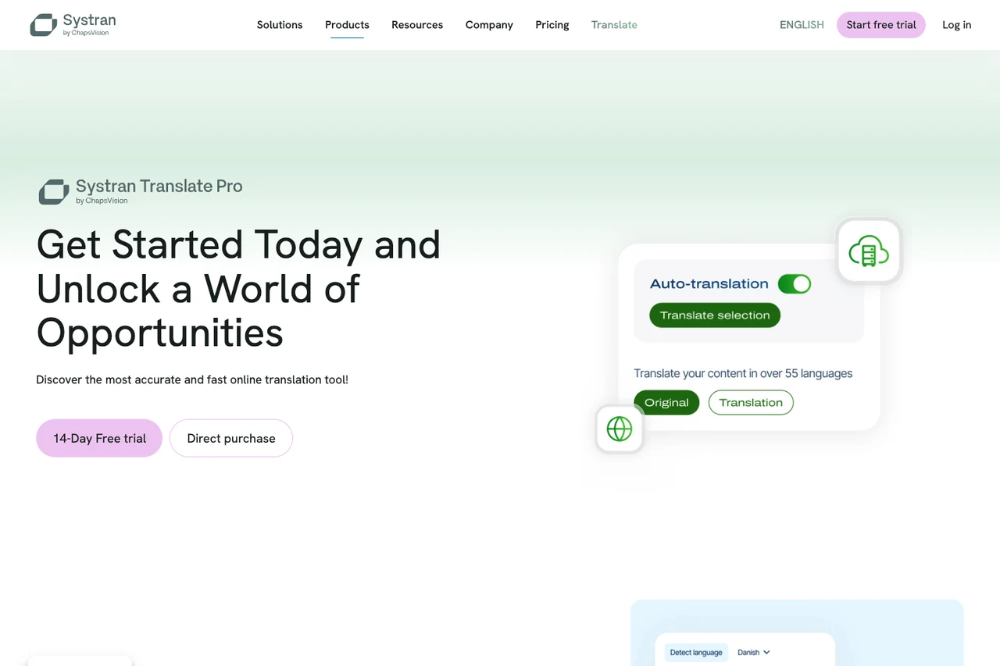 Offizielle Produktübersichtsoberfläche von SYSTRAN Translate Pro

---

## 4. Akademisches Schreiben, Verfeinerung & Human-in-the-Loop-Zusammenarbeit: Den Text feinschleifen

Die Übersetzung ist oft nur die erste Phase eines umfassenderen Schreib- oder Forschungsprozesses. Das Überprüfen von Wörterbuchdefinitionen, das Verfeinern von Formulierungen und interaktives Mensch-Maschine-Editieren tragen dazu bei, formale wissenschaftliche Standards zu gewährleisten.

### Youdao Translate (NetEase Youdao)
Eingebunden in das Wörterbuch-Ökosystem von NetEase Youdao verbindet [Youdao Translate](https://fanyi.youdao.com/) Wortschatzsuche, Übersetzung und Schreibassistenz. Neben der standardmäßigen Text- und Dateiübersetzung bietet das Webportal spezielle Zugänge für die „arXiv-Papierübersetzung“ und akademisches Textpolieren.

Nach der Übersetzung von Forschungsauszügen können Nutzer Grammatikprüfungen durchführen, Synonymoptionen abwägen oder den akademischen Tonfall anpassen, was Studenten und Forschern beim Durcharbeiten ausländischer Fachliteratur und beim Verfassen von Manuskripten hilft. Format- und Sprachbereiche für das Polieren von wissenschaftlichen Arbeiten und Medienmodulen weichen von der allgemeinen Wörterbuchsuche ab.

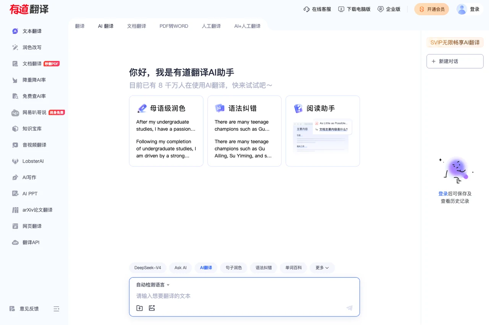 NetEase Youdao Translate Weboberfläche und Funktionsnavigation

### Baidu Translate
[Baidu Translate](https://fanyi.baidu.com/) bietet eine breite Client-Abdeckung für chinesischsprachige Nutzer. Die Desktop-Software verfügt über ein kompaktes schwebendes Fenster und Kurzbefehl-Textauswahl in lokalen Desktop-Apps, während die mobile App Fotoübersetzung, Sprechübungen und Wörterbuchreferenzen kombiniert.

Darüber hinaus betreibt Baidu ein eigenständiges [Baidu Video-Übersetzungsportal](https://fanyi-video.baidu.com/). Nutzer laden Mediendateien hoch, um synchronisierte zweisprachige Untertitelspuren zu generieren, diese in einem Online-Editor zu überprüfen und zu bearbeiten sowie fertige Untertiteldateien zu exportieren. Es handelt sich um ein uploadbasiertes Postproduktionswerkzeug und nicht um einen automatischen Dolmetscher für Live-Web-Wiedergaben.

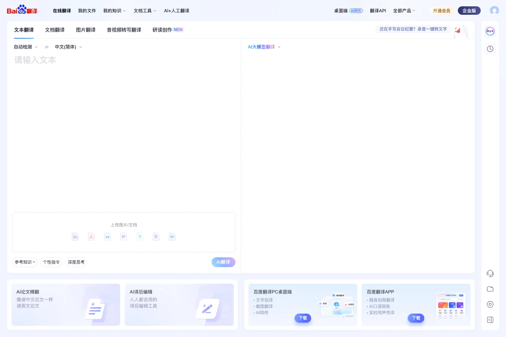 Offizielle Weboberfläche von Baidu Translate

### TranSmart (Tencent Interactive Translation)
Entwickelt von Tencent AI Lab, ist [TranSmart](https://transmart.qq.com/zh-CN/intro) auf die interaktive Mensch-Maschine-Kollaboration ausgelegt. Statt einer statischen Ausgabe zum Kopieren schlägt TranSmart vorausschauende Vervollständigungen auf Wort- und Satzebene in Echtzeit vor und bindet bestätigte zweisprachige Paare in das aktive Translation Memory ein.

Übersetzer können ihren Cursor an einer beliebigen Stelle im übersetzten Text platzieren, um Anpassungen vorzunehmen, woraufhin das System nachfolgende Vorschläge dynamisch aktualisiert. Dadurch bleiben Terminologieentscheidungen und Satzrhythmus in den Händen des Nutzers – konzipiert als kollaborativer Editor mit einem anderen Schwerpunkt als Tencents eigenständige Wörterbuch-Mobil-Apps für Endverbraucher.

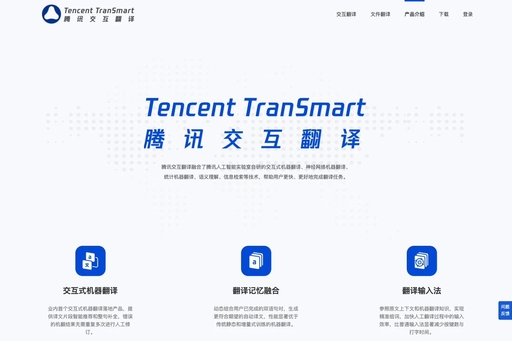 Offizielle Weboberfläche von Tencent TranSmart

### LingoCloud (Caiyun Xiaoyi)
[LingoCloud](https://www.caiyunapp.com/?lang=zh) wird häufig für Chinesisch-, Englisch- und Japanisch-Workflows genutzt. Seine Browser-Erweiterung liefert zweisprachiges Lesen im Web direkt auf der Seite mit Unterstützung für geteilte öffentliche und persönliche Glossare. Sein [Dokumentenübersetzungsdienst](https://docs.caiyunapp.com/lingocloud-app/lingocloud-introduction/app-files-trans.html) (gemäß den Richtlinien der mobilen App) akzeptiert Formate wie PDF, Word, PPT, Excel, EPUB, TXT und SRT, wobei heruntergeladene Ausgaben je nach Ausgangsdatei überwiegend im PDF- oder Word-Format bereitgestellt werden.

Die Desktop-Software umfasst zudem [LingoCloud Interpretation](https://www.caiyunapp.com/interpretation/), das Mikrofonton erfassen oder die Systemaudioausgabe laufender Anwendungen (wie Zoom, Teams oder Chrome unter Windows) abfangen kann, um zweisprachige Live-Untertitel darzustellen. Das Desktop-Dolmetschen unterliegt betriebssystemspezifischen Audioerfassungsgrenzen: Unter Windows funktioniert die Systemaudioerfassung über unterstützte Konferenz- und Medien-Apps hinweg; unter macOS werden interne Systemaudio-Aufnahmerouten aufgrund von macOS-Systemaktualisierungen derzeit nicht unterstützt, sodass die Mikrofonerfassung der funktionierende Weg bleibt.

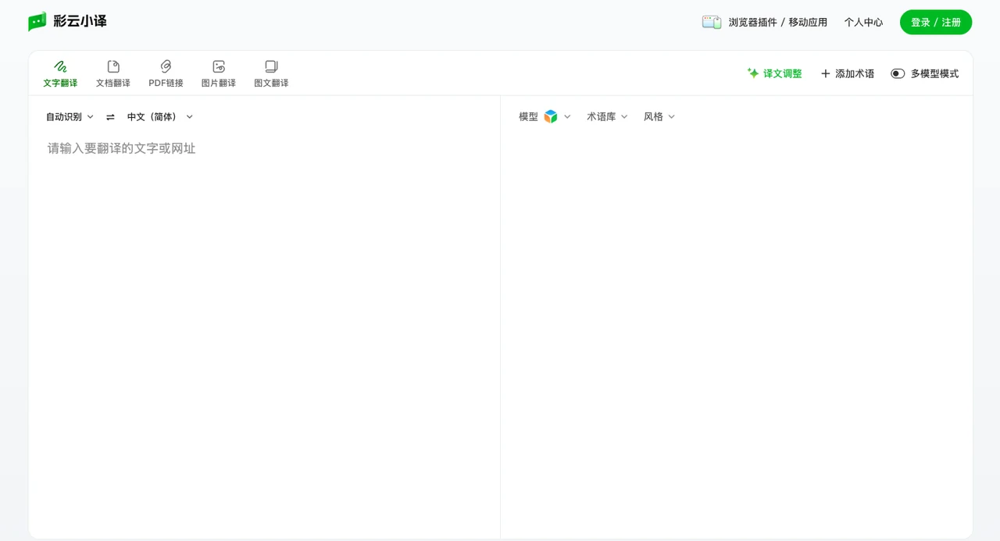 Offizielle Weboberfläche von LingoCloud

### QuillBot Translate
[QuillBot Translate](https://quillbot.com/translate) arbeitet innerhalb des Schreib- und Redaktionsökosystems von QuillBot. Beim Übersetzen von Texten bietet die Benutzeroberfläche Formalitätsoptionen und zeigt Definitionen sowie Synonyme in unterstützten Sprachen an.

Übersetzter Text lässt sich nahtlos in den Paraphraser und den Grammar Checker kopieren, um den Satzfluss zu verfeinern. Die Plattform unterhält zudem eine dedizierte [Translate PDF-Seite](https://quillbot.com/translate-pdf) zum Hochladen und Überprüfen einzelner PDF-Dokumente. Die unterstützten Sprachen variieren zwischen den Übersetzungs-, Grammatik- und Paraphrasierungswerkzeugen.

 Offizielle Chrome Web Store Produktseite für die QuillBot Browser-Erweiterung

---

## 5. Open-Source-Ökosystem: Lokale Engines, APIs, Desktop-Clients & wissenschaftliche PDF-Pipelines

Entwickler, datenschutzbewusste Teams und akademische Forscher benötigen häufig einsehbaren Quellcode, lokale Offline-Ausführung oder maßgeschneiderte Automatisierungs-Pipelines. Das Open-Source-Übersetzungsökosystem erstreckt sich über mehrere unterschiedliche Architekturebenen:

- **Wissenschaftliche PDF-Layout-Tools**: Komplexe akademische Arbeiten übersetzen und dabei mehrspaltige Layouts, Formeln und Abbildungen bewahren.
- **Selbst hostbare Übersetzungsdienste**: HTTP-REST-API-Endpunkte und Web-UIs für die Bereitstellung im lokalen Netzwerk bereitstellen.
- **Eingebettete Offline-Übersetzungs-Engines**: Neuronale maschinelle Übersetzung lokal über Python-Bibliotheken ohne externe Netzwerkabhängigkeiten ausführen.
- **Desktop- & Terminal-Frontends**: Multi-Engine-Abfragen, Zwischenablage-Überwachung, OCR und Shell-Pipelines integrieren.

> [!IMPORTANT]
> Das lokale Ausführen von Open-Source-Code bedeutet nicht automatisch, dass Übersetzungen offline oder privat sind. Ein Werkzeug kann lokal laufen und standardmäßig Cloud-APIs abfragen. Wirklich offline erfolgende Übersetzungen erfordern sowohl lokale Modellressourcen als auch eine lokale Übersetzungs-Engine.

### 5.1 Wissenschaftliche & akademische PDF-Pipelines

#### PDFMathTranslate (pdf2zh)
[PDFMathTranslate](https://github.com/PDFMathTranslate/PDFMathTranslate) (GNU AGPL v3) ist ein Open-Source-Werkzeug, das speziell auf wissenschaftliche und akademische PDF-Dokumente zugeschnitten ist. Es bewahrt mehrspaltige Dokumentstrukturen, mathematische Notation, eingebettete Grafiken, Inhaltsverzeichnisse und Anmerkungen.

- **Dual- und Mono-Ausgaben**: Generiert sowohl rein übersetzte (`-mono.pdf`) als auch zweisprachige Vergleichsdokumente (`-dual.pdf`).
- **Schnittstellen & Integrationen**: Bietet Befehlszeilenwerkzeuge (CLI), ein interaktives WebUI, Docker-Container-Bereitstellung und Unterstützung für das Model Context Protocol (MCP). Ein angebundenes Zotero-Integrations-Plugin ist als Begleitprojekt verfügbar.
- **Übersetzungs-Backends**: Verwendet eine modulare Architektur, die Google Übersetzer (dokumentierter Standard), DeepL, OpenAI-kompatible APIs und lokale Ollama-Instanzen unterstützt. Eine lokale Bereitstellung über Docker oder WebUI bedeutet keinen Offline-Betrieb, wenn Cloud-Backends konfiguriert sind.
- **OCR-Unterstützung**: Enthält experimentelle OCR für gescannte Seiten mit schwarzem Text auf weißem Hintergrund (lädt Sprachmodell-Ressourcen bei der ersten Verwendung herunter, die anschließend lokal wiederverwendet werden können).

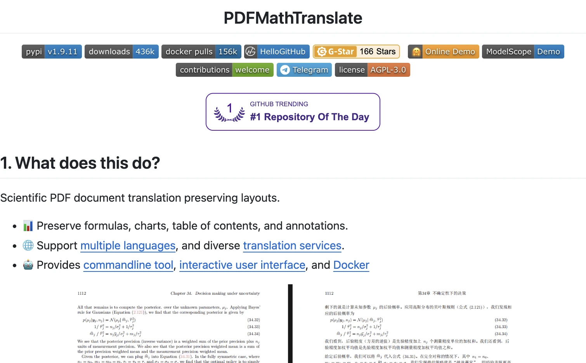 Offizielle Repository-Übersicht von PDFMathTranslate zur Illustration der wissenschaftlichen PDF-Layoutübersetzung und CLI/WebUI-Workflows

#### BabelDOC
[BabelDOC](https://github.com/funstory-ai/BabelDOC) (GNU AGPL v3) ist eine Bibliothek zur wissenschaftlichen Dokumentübersetzung und für zweisprachige Vergleiche auf Dokumentenebene, primär konzipiert zur Einbettung in Python-Anwendungen und begleitet von einer Debugging-CLI.

- **Layout- & Ausgabesteuerung**: Unterstützt Mono- oder Dual-Ausgaben, Gegenüberstellung auf derselben Seite oder abwechselnde Original-/Übersetzungsseiten, selektive Seitenübersetzung, das Aufteilen und Zusammenführen großer PDFs, benutzerdefinierte Glossar-CSV-Eingabe und Formelerhaltung. Die Übersetzung von Tabellentext ist ausdrücklich als experimentell dokumentiert.
- **Backend-Architektur**: Erfordert ein konfiguriertes Übersetzungs-Backend über OpenAI-kompatible Endpunkte oder eine lokale Ollama-Instanz. Als PDF-Verarbeitungs- und Layout-Engine enthält es selbst keine universelle Übersetzungs-Engine.
- **Offline-Ressourcen & Grenzen**: Bietet Warmup-Routinen sowie Offline-Asset-Generierung/-Wiederherstellung für Dokumentenlayoutmodelle und Schriftarten. Eine vollständig offline ablaufende Ausführung erfordert sowohl vorab gecachte Assets als auch ein lokal laufendes Übersetzungs-Backend (wie ein lokales Ollama). Die Dokumentation hebt die primäre Validierung für Englisch-zu-Chinesisch-Workflows hervor, mit einem experimentellen OCR-Workaround für schwarzen Text auf weißem Hintergrund.

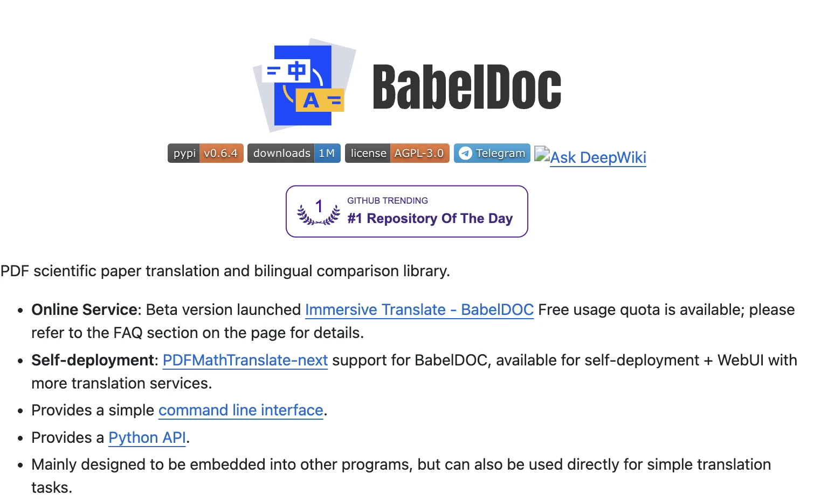 Offizielle Repository-Übersicht von BabelDOC zur Veranschaulichung der Funktionen der wissenschaftlichen PDF-Übersetzungsbibliothek auf Dokumentenebene

### 5.2 Selbst hostbare Engines & APIs

#### LibreTranslate
[LibreTranslate](https://github.com/LibreTranslate/LibreTranslate) (GNU AGPL v3) ist ein kostenloser und quelloffener, selbst hostbarer Dienst für maschinelle Übersetzungs-APIs mit integrierter Weboberfläche, der auf der Argos Translate Engine aufbaut.

- **API & Webdienst**: Stellt REST-API-Endpunkte für Textübersetzung, Ausgangssprachenerkennung und HTML/Markup-Verarbeitung bereit. Er fungiert als unabhängige Dienstschicht und nicht als Proxy für kommerzielle Übersetzungs-APIs.
- **Lokale Bereitstellung & Datenschutz**: Kann nach der Installation von Abhängigkeiten und Sprachmodellen vollständig auf lokaler Hardware ausgeführt werden, ohne Daten an externe Dritte zu senden. Die Nutzung einer öffentlich gehosteten Instanz bleibt netzwerkabhängig. Die API-Schlüssel-Zugriffskontrolle kann je nach Anforderungen des Hosts aktiviert oder deaktiviert werden.
- **Sprachabdeckung & Dateiformate**: Verfügbare Sprachpaare hängen von den installierten Sprachmodellen ab. Über Begleitprojekte wie argos-translate-files unterstützt die Dateiübersetzung Formate wie TXT, ODT, ODP, DOCX, PPTX, EPUB, HTML, SRT und PDF.

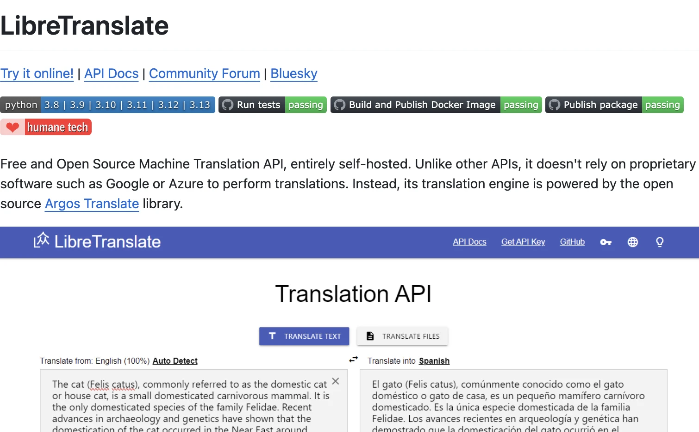 Offizielle Repository-Übersicht von LibreTranslate mit selbst gehosteter Übersetzungs-API und Weboberflächenfunktionen

#### Argos Translate
[Argos Translate](https://github.com/argosopentech/argos-translate) (MIT License / in der README deklarierte CC0-Option) ist eine quelloffene Offline-Python-Übersetzungsbibliothek und ein Befehlszeilenwerkzeug mit einem separat installierbaren GUI-Client.

- **Modulare Modellpakete**: Lädt und verwaltet Sprachmodellpakete mit der Dateiendung `.argosmodel`. Wenn ein direktes Sprachpaar nicht verfügbar ist, kann über installierte Zwischenpaare übersetzt werden (z. B. Pivot-Übersetzung über Englisch).
- **Ökosystem-Engine**: Dient als zugrunde liegende Engine für maschinelle Übersetzung für LibreTranslate. Begleitprojekte erweitern die Funktionen auf HTML-Übersetzung (`translate-html`) und Dateiverarbeitung (`argos-translate-files`).
- **Offline-Betrieb**: Läuft nach der Installation der Modelle vollständig offline; das Herunterladen von Paketindizes und anfänglichen Modellen erfordert eine Internetverbindung.

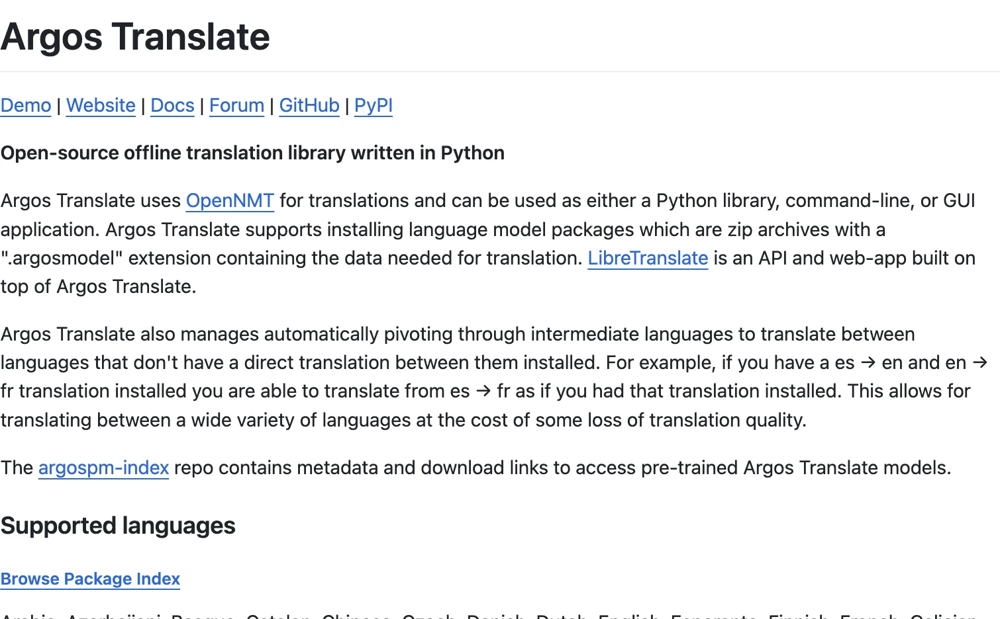 Offizielle Repository-Übersicht von Argos Translate mit Details zur modularen Offline-Übersetzungs-Engine und zum Paketsystem

### 5.3 Desktop- & Terminal-Frontends

#### Pot (pot-desktop)
[Pot](https://github.com/pot-app/pot-desktop) (GNU GPL v3) ist ein plattformübergreifendes Desktop-Übersetzungswerkzeug für Windows, macOS und Linux, das Auswahlübersetzung per Hotkey, getippte Eingabe, Zwischenablage-Überwachung, Screenshot-OCR und Screenshot-Übersetzung unterstützt. Das offizielle GitHub-Repository wurde am 7. September 2026 archiviert und ist schreibgeschützt (read-only).

- **Multi-Dienst-Aggregation**: Ermöglicht das gleichzeitige Abfragen mehrerer Übersetzungs- und Wörterbuchdienste, um Ergebnisse nebeneinander zu vergleichen. Unterstützt Text-to-Speech (TTS), Vokabelexport nach Anki und Eudic sowie Plugin-Erweiterungen.
- **Modulare Backends & OCR**: Aggregiert Cloud-Übersetzungsanbieter, OpenAI-kompatible APIs und lokale Ollama-Endpunkte. Zu den OCR-Optionen gehören plattformnative Optionen (Windows-System-OCR, Apple Vision, Linux Tesseract), Tesseract.js oder lokale Plugins.
- **Offline-Ausführungsrouten**: Die Übersetzung von markiertem und getipptem Text erfordert lediglich ein konfiguriertes lokales Übersetzungs-Backend (wie eine lokale Ollama-Instanz); die Screenshot-Übersetzung erfordert zusätzlich eine Offline-OCR-Engine (wie plattformnative OCR oder Tesseract). Cloud-Dienste leiten Anfragen über das Netzwerk weiter.

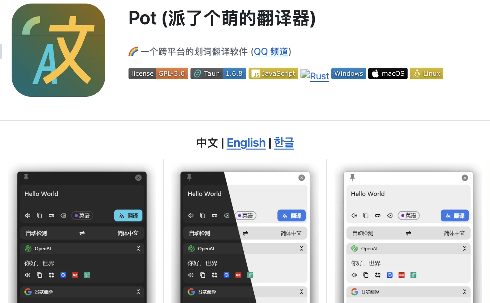 Offizielle Repository-Übersicht des Desktop-Clients Pot mit Hervorhebung von Multi-Interface-Übersetzung, OCR und Zwischenablage-Workflows

#### Translate Shell
[Translate Shell](https://github.com/soimort/translate-shell) (The Unlicense / Public Domain) ist ein vielseitiges Befehlszeilen-Übersetzungswerkzeug (ausführbare Datei `trans`) für Unix-ähnliche Terminalumgebungen.

- **CLI-Abfrage & Wörterbuch**: Unterstützt Wortdefinitionen, Phrasenübersetzung, einen prägnanten Wörterbuchmodus, interaktive REPL-Sitzungen und Spracherkennung direkt in der Shell.
- **Unix-Pipelines**: Integriert sich mit Standard-Ein-/Ausgabe (`stdin` / `stdout`), verarbeitet reine Textdateien direkt und unterstützt Sprachsynthese, wenn ein externer Audioplayer installiert ist.
- **Engine-Ebene**: Fungiert als leichtgewichtiges Client-Frontend, das sich mit öffentlichen Übersetzungsdiensten verbindet (standardmäßig Google Translate; zudem werden Bing Translator, Yandex.Translate und Apertium unterstützt).
- **Grenzen**: Bringt keine lokalen neuronalen Übersetzungsmodelle mit; der Standardbetrieb hängt von einer externen Netzwerkverbindung zu den ausgewählten Engine-Diensten ab. Die Dateiübersetzung ist für reine Textströme ausgelegt, nicht für formatierte Dokumente.

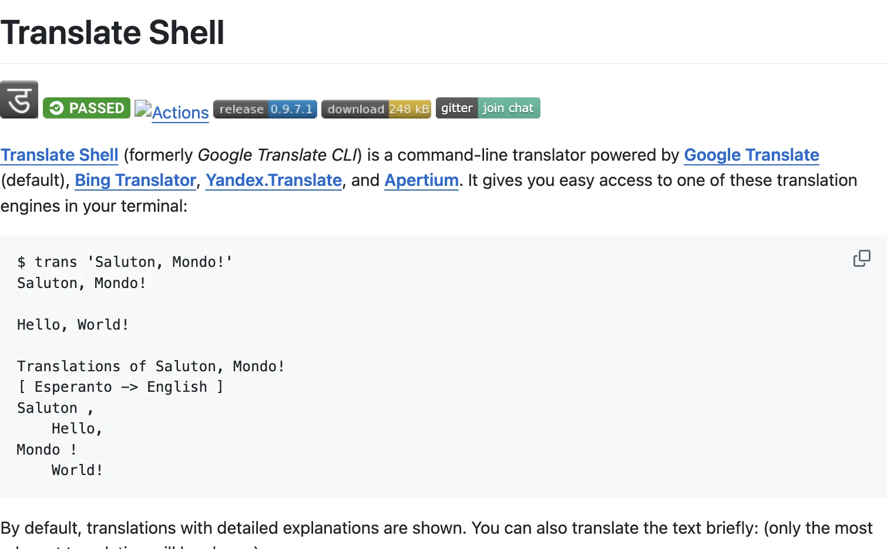 Offizielle Repository-Übersicht von Translate Shell mit Terminal-Kommandozeilenübersetzung und Pipeline-Integration

---

## 6. Verknüpfte End-to-End-Workflows: [Equalang](https://equalang.com/?utm_source=github)

Der Überblick über diese Werkzeuge zeigt, dass jeder Dienst ausgeprägte Stärken für spezifische Aufgaben entwickelt hat. Im Arbeitsalltag überschneiden sich die Anforderungen jedoch häufig:

Vielleicht lesen Sie ein Online-Whitepaper im Browser, laden ein zugehöriges PDF mit Tabellen und Diagrammen herunter, schauen sich eine Vorlesung als Video ohne Untertitel an und erstellen anschließend eine Zusammenfassung in Word, während Sie sich direkt mit internationalen Partnern abstimmen. Der Wechsel zwischen isolierten Softwarewerkzeugen und Dateikonvertern fragmentiert den Arbeitsablauf.

Wir haben **[Equalang](https://equalang.com/?utm_source=github)** entwickelt, um diese Aufgaben in einem durchgängigen, synoptischen (nebeneinanderliegenden) Übersetzungs-Workflow zusammenzuführen und koordinierte Übersetzungsunterstützung über Dokumente, Webseiten, Videos und Live-Kommunikation hinweg zu bieten.

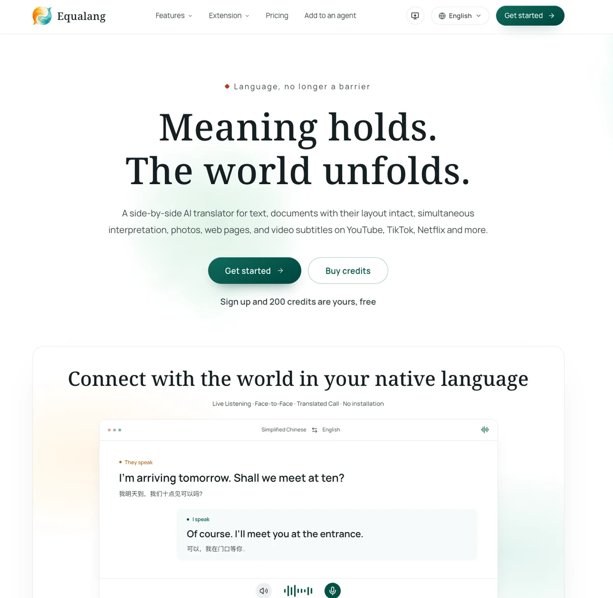 Offizielle englische Website-Startseite von <a href="https://equalang.com/?utm_source=github">Equalang</a>

### 1. Vollständige Dokumentenübersetzung unter Beibehaltung des Layouts
Bei der Übersetzung ganzer Dokumente konzentriert sich [Equalang](https://equalang.com/?utm_source=github) auf die strukturelle Erhaltung und die Verwendbarkeit nach der Übersetzung und bietet maßgeschneiderte Arbeitsabläufe für Forschungsliteratur, Präsentationen und alltägliche Office-Dateien:

- **PDF-Dokumente & Lesen**: [Equalang](https://equalang.com/?utm_source=github) bewahrt mehrspaltige Layouts, Kopf- und Fußzeilen sowie Bildunterschriften, fügt durch Seitenumbrüche getrennte Sätze vor dem Übersetzen wieder zusammen und behält Tabellenstrukturen, Inline-Formeln und interne Dokumentlinks bei. Wie in unserem [Leitfaden zum Lesen akademischer PDFs](https://equalang.com/blog/translate-and-read-pdf-documents?utm_source=github) beschrieben, können Leser die übersetzte Datei Seite an Seite neben dem Original betrachten, zentrale Argumente zunächst in ihrer Erstsprache erfassen und anschließend spezifische Begriffe und Daten auf der Originalseite gegenprüfen.

- **PowerPoint-Präsentationen**: In unserem [Leitfaden zur Formatierung von Präsentationen](https://equalang.com/blog/translate-powerpoint-keep-formatting?utm_source=github) behalten übersetzte PPTX-Dateien native, bearbeitbare Tabellen bei, anstatt sie zu statischen Bildern zu reduzieren. Formatierungen auf Wortebene – wie Fettdruck, Kursivschrift und Schriftfarben innerhalb eines einzelnen Satzes – werden präzise auf die entsprechenden übersetzten Phrasen übertragen. Wichtige Begriffe und Überschriften bleiben über alle Folien hinweg konsistent, und Textfelder verkleinern die Schriftgröße bei Textdehnung in der Übersetzung automatisch, um Textüberläufe oder das Verdecken von Grafiken zu verhindern.

- **Word- & Excel-Office-Dateien**: In unserem verifizierten [Word-Übersetzungstest](https://equalang.com/blog/translate-word-document-keep-formatting?utm_source=github) behielten übersetzte DOCX-Dateien Überschriften, Aufzählungslisten, Preistabellen und Fettformatierungen bei und ermöglichten die direkte Weiterbearbeitung in Microsoft Word. In unserer [Validierung von Excel-Preislisten](https://equalang.com/blog/translate-excel-file?utm_source=github) blieben Formeln und Zahlen unangetastet, während identische Textzeichenfolgen über mehrere Zellen hinweg nur einmal übersetzt wurden.

- **E-Books & formatierte Medien**: EPUB-E-Books behalten die Navigation im Inhaltsverzeichnis und interne Ankerlinks bei. Bei aufgezeichneten Audio- und Videodateien von bis zu 180 Minuten werden Übersetzungs- und Transkriptionsaufgaben über unsere Entwickler-API und Agent Skill/MCP-Integration eingereicht (statt über ein allgemeines Web-Dokumentenupload-Portal) und liefern mit Zeitstempeln versehene zweisprachige SRT/VTT-Untertiteldateien oder Quelltranskripte.

### 2. Lesen im Browser & Untertitelgenerierung
Über unsere schlanke [Browser-Erweiterung](https://equalang.com/extension?utm_source=github) (mit Installationsanleitungen für Chrome, Edge und Firefox sowie einem temporären Mac-Safari-Modus für Safari 18.4+) integriert sich die Übersetzung nahtlos in Ihr tägliches Lesen:

- **Zweisprachiges Web-Lesen unter dem Absatz**: Übersetzte Absätze erscheinen beim Scrollen direkt unter dem Originaltext. Ein schwebendes Symbol kann in den Einstellungen für Wortabfragen bei Bedarf aktiviert werden. Beim Betrachten lokaler PDFs können Nutzer in der Erweiterungsverwaltung die Option „Zugriff auf Datei-URLs zulassen“ aktivieren, um Wörter zur Abfrage zu markieren.

- **Zweisprachige Video-Untertitel**: Kompatibel mit YouTube, Netflix, TikTok und Bilibili, wie in unserem [Leitfaden für zweisprachigen Videogenuss](https://equalang.com/blog/watch-videos-with-bilingual-subtitles?utm_source=github) erläutert. Über das Übersetzen bestehender Untertitel hinaus kann die Erweiterung Audioströme erfassen, um zweisprachige Echtzeit-Untertitel für **Videos ohne Untertitel** zu generieren (vorbehaltlich Browserumgebung und Medienverschlüsselungsgrenzen, verifiziert bei YouTube-Livestreams und offiziellen Trailern), während gleichzeitig Live-Chat-Kommentare auf YouTube übersetzt werden.

### 3. Installationsfreie gesprochene Kommunikation & Vor-Ort-Austausch
Gesprächspartner zur Installation spezieller mobiler Anwendungen aufzufordern, schafft Hürden, insbesondere auf Reisen. Bei bestehender Internetverbindung bietet [Equalang](https://equalang.com/?utm_source=github) mobile Fotoübersetzung und gesprochenes Dolmetschen direkt in Standard-Browsern (erfordert lediglich eine erstmalige Anmeldung und die Freigabe von Kamera/Mikrofon bei der ersten Nutzung), wie in unserem [Leitfaden für internationale Kommunikation](https://equalang.com/blog/talk-with-overseas-partners?utm_source=github) beschrieben:

- **Mobile Fotoübersetzung**: Wenn Sie auf Reisen auf unbekannte Speisekarten, Schilder oder Aushänge stoßen, können Sie ein Foto in Ihrem mobilen Browser aufnehmen. Die Übersetzungen legen sich direkt über das Fotolayout, was das Bestellen von Getränken oder das Prüfen von Hinweisen im Abgleich mit dem Originalbild erleichtert, wie in unserem [Leitfaden für Reise-Fotoübersetzung](https://equalang.com/blog/photo-translation-for-travel?utm_source=github) veranschaulicht.

- **Face-to-Face-Modus**: Entwickelt für persönliche Situationen wie die Gepäckaufbewahrung im Hotel, das Fragen nach dem Weg oder Interaktionen am Empfang. Zwei Sprecher können ein einzelnes Smartphone oder Tablet flach zwischen sich legen und eine invertierte Split-Screen- oder Side-by-Side-Ansicht mit fortlaufender bidirektionaler Transkription und Transkriptexport nutzen, wie in unserem [Leitfaden für Face-to-Face-Reisen](https://equalang.com/blog/talk-face-to-face-while-traveling?utm_source=github) gezeigt.

- **Live-Zuhören**: Öffnen Sie das Webportal während einer Präsentation oder Vorlesung vor Ort, um zweisprachige Echtzeit-Untertitel zu erhalten, die über das physische Mikrofon des Geräts erfasst werden – mit optionaler Text-to-Speech-Audioausgabe und Transkriptexport nach Abschluss (abgegrenzt von der Streaming-Audioerfassung der Browser-Erweiterung).

- **Übersetzte Anrufe**: Gastgeber melden sich im Webportal an, um einen sicheren Anruflink zu erstellen und ihn über eine beliebige Messaging-App zu teilen. **Gäste treten direkt über ihren Browser bei, ohne ein Konto zu erstellen oder Software zu installieren** – sie geben einfach einen Anzeigenamen ein und der Gastgeber lässt sie eintreten, um den Anruf zu starten. Beide Parteien sprechen in ihrer Muttersprache, hören übersetztes Audio und sehen Echtzeit-Text.

### 4. Integration für KI-Agenten und Entwickler
Um Entwicklern und Teams die Einbindung von Übersetzungen in automatisierte Arbeitsabläufe zu erleichtern:

- **Entwickler-API**: Bietet synchrone Endpunkte für Text sowie asynchrone Dateiaufträge mit Unterstützung für Idempotency-Key-Wiederholungsversuche und Callback-Benachrichtigungen, wie in unserem [Leitfaden zur Integration der Dateiübersetzungs-API](https://equalang.com/blog/integrate-file-translation-api?utm_source=github) detailliert beschrieben.

- **Skill- & MCP-Integration**: Wir pflegen Open-Source-Agent-Skills über [equalang-skill](https://github.com/equalang/equalang-skill) und offizielle Unterstützung für das Model Context Protocol über [@equalang/mcp](https://github.com/equalang/equalang-mcp). In Umgebungen wie Claude Code, Codex oder WorkBuddy genügen ein einzelner Installations-Prompt und die Konfiguration Ihres API-Schlüssels, damit Ihr KI-Assistent Dokumentenübersetzung und Medientranskription direkt innerhalb Ihres Arbeitsablaufs durchführen kann – gemäß unserem [Leitfaden zur Dateiübersetzung mit KI-Assistenten](https://equalang.com/blog/translate-files-with-ai-assistants?utm_source=github).

---

## 7. Aufgabenbasierter Entscheidungsleitfaden

Orientieren Sie sich an dieser Aufgabenmatrix, um das passende Werkzeug für Ihre aktuelle Aufgabe auszuwählen:

| Hauptaufgabe | Kernanforderung | Empfohlene Werkzeuge | Wichtige Erwägungen |
| :--- | :--- | :--- | :--- |
| **Reisen & gesprochener Dialog** | Foto-OCR, bidirektionaler Dialog, Offline-Pakete & vernetzte Reisewerkzeuge | Google Translate, Apple Translate, Papago, [Equalang](https://equalang.com/?utm_source=github) | Laden Sie Offline-Sprachpakete in Google, Apple oder Papago herunter (unter Beachtung der Hardwareanforderungen) für Gebiete mit schwachem Empfang; bei bestehender Verbindung bietet [Equalang](https://equalang.com/?utm_source=github) browserbasierte Fotoübersetzung und Face-to-Face-Dialoge ohne App-Installation. |
| **Geräteübergreifende Workshops** | Eins-zu-viele-Präsentationen, geräteübergreifende Teilnahme | Microsoft Translator | Der Gastgeber führt den Präsentationsmodus über die mobile App aus; Teilnehmer treten über Standard-Browser bei, ohne Software zu installieren. |
| **Vertieftes Lesen im Web** | Lesen unter dem Absatz ohne Seitenwechsel | Immersive Translate, [Equalang](https://equalang.com/?utm_source=github), Mate Translate | Verwenden Sie Immersive Translate oder [Equalang](https://equalang.com/?utm_source=github) für zweisprachige Absätze; nutzen Sie Mate Translate zum Umschalten von Ganzseitenansichten oder zum Speichern von Wörtern in Phrasenbüchern auf dem Mac. |
| **Videos ohne Untertitel & Livestreams** | Echtzeit-Untertitelgenerierung, Streaming-Kompatibilität | [Equalang](https://equalang.com/?utm_source=github), Immersive Translate | Beide Werkzeuge können auf unterstützten Plattformen (wie YouTube) Untertitel aus Rohaudiodaten erzeugen; vergleichen Sie die Workflows der Browser-Erweiterungen für Live-Chat und Streaming-Verarbeitung. |
| **Wissenschaftliche Arbeiten & PDFs** | Formelerhaltung, Spaltenstrukturen, seitenübergreifender Text | PDFMathTranslate, BabelDOC, [Equalang](https://equalang.com/?utm_source=github) | PDFMathTranslate und BabelDOC bieten Open-Source-Pipelines mit Dual-PDF-Ausgabe und lokalen/Cloud-LLM-Backends; [Equalang](https://equalang.com/?utm_source=github) bietet browserbasiertes Side-by-Side-Lesen und Layouterhaltung. |
| **Druckvorstufe & Designformate** | InDesign, Illustrator, Comic-Archive, Druckvorstufen-QS | SimplifyAI, O.Translator | Nutzen Sie SimplifyAI und O.Translator für InDesign (IDML) und die Druckvorstufe von Designressourcen; SimplifyAI umfasst KI-Editierung mit nativer Word-Änderungsverfolgung. |
| **Präsentationen & Office-Dokumente** | Erhaltung nativer Tabellen, Stile, Formeln und Editierbarkeit | [Equalang](https://equalang.com/?utm_source=github), DeepL | [Equalang](https://equalang.com/?utm_source=github) bewahrt native Tabellen/Stile in PPTX mit adaptiver Schriftgrößenanpassung und behält Excel-Formeln bei; nutzen Sie DeepL für unternehmensweite Word-/Office-Dateien mit Glossaren. |
| **Akademisches Schreiben & Polieren** | Grammatikalische Präzision, formeller wissenschaftlicher Tonfall | Youdao Translate, QuillBot Translate, TranSmart | Youdao und QuillBot verbinden Übersetzung nahtlos mit Textverfeinerung; TranSmart bietet interaktive Human-in-the-Loop-Bearbeitung. |
| **Desktop-Hotkey-Suche & Multi-Engine** | Globale Tastenkombinationen, OCR, Vergleich mehrerer Engines | Pot, Mate Translate | Pot ermöglicht simultane Multi-Engine-Abfragen und Screenshot-OCR unter Windows, Mac und Linux; Mate bietet ein natives Dienstprogramm für die Mac-Menüleiste. |
| **Terminal-Scripting & Shell-Pipelines** | CLI-Abfrage, stdin/stdout-Pipelines, reine Textskripte | Translate Shell, Argos Translate | Translate Shell bietet leichtgewichtige CLI-Übersetzung über Remote-Engines; Argos Translate bietet eine Offline-Python-CLI mit lokalen Modellen. |
| **Selbst gehostete private API & Offline-Engines** | Getrennte Netzwerke (Air-Gapped), keine Datenübertragung an Dritte | LibreTranslate, Argos Translate, SYSTRAN, Lingvanex | LibreTranslate bietet einen selbst gehosteten HTTP-API-Dienst und ein WebUI; Argos Translate treibt es als Offline-Python-Bibliothek/CLI-Engine mit modularen Modellpaketen an; SYSTRAN und Lingvanex bieten On-Premise-Bereitstellungen für Unternehmen. |
| **Verknüpfte End-to-End-Workflows** | Dokumente, Streaming-Untertitel, Web-Anrufe und KI-Agenten | [Equalang](https://equalang.com/?utm_source=github) | Einheitliche Dokumentenverarbeitung, Untertitel für Medien ohne Untertitel, browserbasierte Anrufe ohne App-Installation und direkte Integration in Claude Code oder WorkBuddy. |

---

## 8. Verzeichnisprinzipien & Prüfkriterien

Um den praktischen Nutzen und die sachliche Genauigkeit dieses Verzeichnisses zu wahren, folgen die Einträge strengen Aufnahme- und Prüfkriterien:

1. **Dokumentierte Funktionen vor Marketingversprechen**: Beschreibungen basieren auf offizieller Dokumentation, Benutzerhandbüchern und bestätigten Quellcodedateien der Repositories. Wir behaupten weder eine perfekte Layouterhaltung noch universelle Formatunterstützung.
2. **Klare architektonische Grenzen**: Wir unterscheiden zwischen Übersetzungs-Frontends, selbst hostbaren Serviceschichten, Offline-Übersetzungs-Engines und Dokumentenlayout-Bibliotheken. Lokal ausgeführter Open-Source-Code wird ausdrücklich von echter Offline-Ausführung getrennt.
3. **Aufgabenorientierte Abdeckung**: Werkzeuge werden nach ihrer praktischen Eignung für Arbeitsabläufe gruppiert. Wir führen keine subjektiven Bestenlisten, Qualitätsrankings oder kurzlebigen Preisangaben.
4. **Transparente Identität der Verwalter**: Dieser Katalog wird vom **[Equalang](https://equalang.com/?utm_source=github)**-Team kuratiert und gepflegt. [Equalang](https://equalang.com/?utm_source=github) wird neben anderen Werkzeugen mit überprüfbaren Funktionsgrenzen und transparenten Systemanforderungen dargestellt.

**Schlagwörter**: Übersetzungswerkzeuge, Dokumentenübersetzung, zweisprachiges Lesen im Web, akademische PDF-Übersetzung, Open-Source-Übersetzung, API für maschinelle Übersetzung, Layouterhaltung, KI-Agenten.

---

## 9. Quellen

1. [Google Übersetzer Hilfe](https://support.google.com/translate)
2. [Google Übersetzer Desktop-Dokumentenübersetzung](https://support.google.com/translate/answer/2534559?co=GENIE.Platform%3DDesktop&hl=en)
3. [Apple Support: Übersetzen-App Benutzerhandbuch für das iPhone](https://support.apple.com/en-gb/guide/iphone/iphd74cb450f/ios)
4. [Apple Support: Live-Übersetzung & Funktionsverfügbarkeit](https://support.apple.com/en-us/123720)
5. [Microsoft Translator Mobile Funktionen](https://www.microsoft.com/en-us/translator/apps/features/)
6. [Microsoft Translator Hilfe zu geräteübergreifenden Konversationen](https://www.microsoft.com/en-us/translator/help/multi-device-conversation/)
7. [NAVER Papago Offizielles Portal](https://papago.naver.com/)
8. [iTranslate Tastatur- & Offline-Funktionen](https://itranslate.com/features/keyboard-translations/index.html)
9. [Reverso Context Nutzungsinformationen](https://context.reverso.net/translation/about)
10. [Reverso Documents Portal](https://www.reverso.net/documents/en)
11. [Yandex Translate Hilfe für Desktop & Mobilgeräte](https://yandex.com/support/translate-desktop/en/)
12. [Immersive Translate Dokumentation](https://immersivetranslate.com/)
13. [O.Translator Produktinformationen & Formate](https://otranslator.com/en/product-info)
14. [SimplifyAI Workbench für komplexe Dokumente](https://simplifyai.cn/zh/translate)
15. [SimplifyAI Allgemeine Dokumentenübersetzung](https://translate.simplifyai.cn/)
16. [Mate Translate Funktionen](https://matetranslate.com/en)
17. [Lingvanex Windows Übersetzer](https://lingvanex.com/products/windows-translator/)
18. [Lingvanex Secure Translation Software](https://lingvanex.com/products/secure-translation-software/)
19. [SYSTRAN Translate Pro & Unternehmens-Bereitstellungen](https://www.systransoft.com/translation-products/translate-pro/)
20. [NetEase Youdao Translate](https://fanyi.youdao.com/)
21. [Baidu Translate & Video-Übersetzungsportal](https://fanyi.baidu.com/)
22. [Tencent TranSmart Produkteinführung](https://transmart.qq.com/zh-CN/intro)
23. [Caiyun Xiaoyi (LingoCloud) Dokumentenhilfe](https://docs.caiyunapp.com/lingocloud-app/lingocloud-introduction/app-files-trans.html)
24. [QuillBot Translate & PDF-Portal](https://quillbot.com/translate)
25. [Equalang API-Spezifikationen & Dokumentation](https://equalang.com/llms-full.txt?utm_source=github)
26. [Offizielles GitHub-Repository von PDFMathTranslate](https://github.com/PDFMathTranslate/PDFMathTranslate)
27. [PDFMathTranslate Dokumentation erweiterter Optionen](https://github.com/PDFMathTranslate/PDFMathTranslate/blob/main/docs/ADVANCED.md)
28. [Offizielles GitHub-Repository von BabelDOC](https://github.com/funstory-ai/BabelDOC)
29. [Offizielles GitHub-Repository von LibreTranslate](https://github.com/LibreTranslate/LibreTranslate)
30. [LibreTranslate Dokumentation & API-Leitfaden](https://docs.libretranslate.com/)
31. [Offizielles GitHub-Repository von Argos Translate](https://github.com/argosopentech/argos-translate)
32. [Offizielles GitHub-Repository von Pot Desktop Translation](https://github.com/pot-app/pot-desktop)
33. [Offizielles GitHub-Repository von Translate Shell](https://github.com/soimort/translate-shell)
