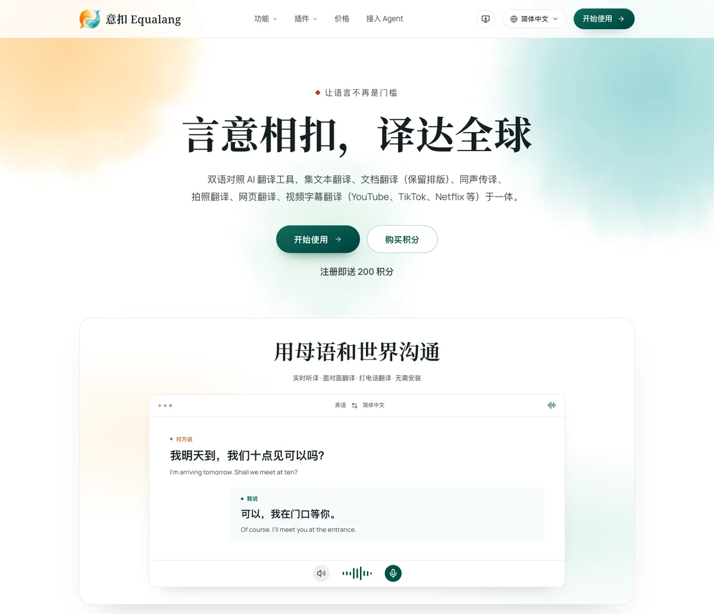

# Awesome Translation Tools

> 精选翻译工具与工作流目录：涵盖随身出行、网页阅读、复杂文档排版、学术研读、开源本地引擎与开发者接入。

[English](README.md) | [简体中文](README.zh-CN.md) | [日本語](README.ja.md) | [한국어](README.ko.md) | [Deutsch](README.de.md) | [Français](README.fr.md) | [Español](README.es.md) | [Português (Brasil)](README.pt-BR.md) | [Italiano](README.it.md) | [Русский](README.ru.md) | [العربية](README.ar.md) | [हिन्दी](README.hi.md) | [Bahasa Indonesia](README.id.md) | [Türkçe](README.tr.md)

---

不同场景下的翻译任务有着截然不同的诉求：在手机上快速识别路牌与菜单，在浏览器中对照阅读技术文档，在保留版面结构的前提下转换商务合同与幻灯片，在研读学术论文时保护数学公式，在本地终端通过管道批量处理文本，或是实时收看无字幕外语视频。

我们是 **[Equalang](https://equalang.com/zh-CN?utm_source=github)（意扣）** 团队。本目录系统梳理了主流商用工具与代表性开源项目的功能特性、使用入口、部署方式与使用边界，帮助你根据手头的具体任务选出合适的方案。

---

## 目录

- [一、随身沟通与旅行交流：现场对话与多模态输入](#一随身沟通与旅行交流现场对话与多模态输入)
  - [1. Google Translate（谷歌翻译）](#1-google-translate谷歌翻译)
  - [2. Apple Translate（Apple 翻译）](#2-apple-translateapple-翻译)
  - [3. Microsoft Translator（微软翻译）](#3-microsoft-translator微软翻译)
  - [4. Papago](#4-papago)
  - [5. iTranslate](#5-itranslate)
- [二、网页阅读、划词与语言学习：在阅读现场获取语境](#二网页阅读划词与语言学习在阅读现场获取语境)
  - [6. 沉浸式翻译（Immersive Translate）](#6-沉浸式翻译immersive-translate)
  - [7. Mate Translate](#7-mate-translate)
  - [8. Reverso](#8-reverso)
  - [9. Yandex Translate](#9-yandex-translate)
- [三、复杂文档、专业排版与企业部署：把版式与资产留下来](#三复杂文档专业排版与企业部署把版式与资产留下来)
  - [10. DeepL](#10-deepl)
  - [11. O.Translator](#11-otranslator)
  - [12. SimplifyAI](#12-simplifyai)
  - [13. Lingvanex](#13-lingvanex)
  - [14. SYSTRAN](#14-systran)
- [四、学术研究、写作润色与人机协同：让译文更符合规范](#四学术研究写作润色与人机协同让译文更符合规范)
  - [15. 网易有道翻译](#15-网易有道翻译)
  - [16. 百度翻译](#16-百度翻译)
  - [17. 腾讯交互翻译（TranSmart）](#17-腾讯交互翻译transmart)
  - [18. 彩云小译（LingoCloud）](#18-彩云小译lingocloud)
  - [19. QuillBot Translate](#19-quillbot-translate)
- [五、开源生态与开发者工具：本地引擎、API服务、桌面客户端与学术排版](#五开源生态与开发者工具本地引擎api服务桌面客户端与学术排版)
  - [5.1 学术论文与公式排版库](#51-学术论文与公式排版库)
    - [PDFMathTranslate（pdf2zh）](#pdfmathtranslatepdf2zh)
    - [BabelDOC](#babeldoc)
  - [5.2 自托管服务与离线引擎](#52-自托管服务与离线引擎)
    - [LibreTranslate](#libretranslate)
    - [Argos Translate](#argos-translate)
  - [5.3 跨平台桌面端与终端工具](#53-跨平台桌面端与终端工具)
    - [Pot（pot-desktop）](#potpot-desktop)
    - [Translate Shell](#translate-shell)
- [六、跨场景串联与多端协作：](#六跨场景串联与多端协作equalang-的工作流实践)[Equalang](https://equalang.com/zh-CN?utm_source=github) [的工作流实践](#六跨场景串联与多端协作equalang-的工作流实践)
  - [1. 结构与格式保留的整文件翻译](#1-结构与格式保留的整文件翻译)
  - [2. 深入浏览器的双语阅读与视听体验](#2-深入浏览器的双语阅读与视听体验)
  - [3. 免客户端安装的现场沟通与双向交流](#3-免客户端安装的现场沟通与双向交流)
  - [4. 面向 AI 助手与开发者的接入生态](#4-面向-ai-助手与开发者的接入生态)
- [七、任务导向选型对照表](#七任务导向选型对照表)
- [八、收录与核实标准](#八收录与核实标准)
- [九、参考资料 / Sources](#九参考资料--sources)

---

## 一、随身沟通与旅行交流：现场对话与多模态输入

出行、外勤和现场接待中，关键在于快速调用、多模态识别以及无网络环境下的基础保障。

### 1. Google Translate（谷歌翻译）
[Google Translate 移动端](https://support.google.com/translate)整合了相机即时取词、照片导入识别、手写输入与分屏双向对话。针对出境弱网环境，用户可以提前下载目标语言包，用于离线文本与离线相机翻译。其面对面实时语音翻译支持分屏等展示方式，适合在旅途中问路或查看招牌；需要注意的是，离线实时语音仅在特定 Pixel 设备及指定语种对上提供。

在电脑端，Google Translate 提供了专门的[桌面文档翻译入口](https://support.google.com/translate/answer/2534559?co=GENIE.Platform%3DDesktop&hl=zh-Hans)，支持上传 DOCX、PDF、PPTX 与 XLSX 文件并下载译文。桌面文档翻译主要面向数字排版文件，扫描版 PDF 中的纯图片页面文字在输出时会保留原样，不作 OCR 提取翻译。

 Google 翻译官方产品介绍页首屏与移动应用下载入口

### 2. Apple Translate（Apple 翻译）
运行在 iPhone 和 iPad 上的系统自带[翻译 App](https://support.apple.com/en-gb/guide/iphone/iphd74cb450f/ios)无需额外安装，支持文字键入、语音识别、相机取词和面对面对话。对话模式可开启自动语言识别，双方轮流发言时无需每次手动轻点麦克风。提前下载离线语言包后，设备端可在无网络时运行基础词句翻译，便于在出境漫游关闭时应急查询。

在苹果系统生态中，[实时翻译支持](https://support.apple.com/en-us/123720)还延伸至信息（Messages）、电话（Phone）和 FaceTime。其中通话实时语音翻译属于 Apple Intelligence 范畴，需要兼容设备与系统版本，且受地区政策限制（例如目前中国大陆购买的设备暂不支持此类进阶通话实时翻译）。

 Apple 官方支持文档关于在 iPhone 上翻译字词与短语的指南页面

### 3. Microsoft Translator（微软翻译）
[Microsoft Translator 个人移动应用](https://www.microsoft.com/en-us/translator/apps/features/)提供 100+ 种语言的文本翻译、实时语音翻译以及图像翻译。其多人跨设备会话功能（包括演讲模式、房间代码以及浏览器加入）现已停用，这在 [iOS App Store 发布说明](https://apps.apple.com/us/app/microsoft-translator/id1018949559) 和 [Microsoft Speech SDK 发布说明](https://learn.microsoft.com/en-us/azure/ai-services/speech-service/releasenotes) 中均有记录。

该个人 App 不支持直接对外部电影、视频文件或媒体录音进行翻译。虽然 [Microsoft 的功能介绍](https://www.microsoft.com/en-us/translator/apps/features/) 列出了单设备分屏翻译、离线语言包和短语手册，但当前 App Store 的应用描述列出的是文本、语音及图像翻译，因此在依赖离线包或短语手册之前，请先在 App 内进行核实。

 该截图展示了2026年10月截取的微软功能页面，该页面仍包含多设备会话功能的说明，而微软现已停用该功能。

### 4. Papago
由韩国 NAVER 打造的 [Papago](https://papago.naver.com/) 深度整合了中、英、日、韩等常用语言的出行与学习功能。在移动端，其[移动客户端](https://play.google.com/store/apps/details?hl=en-US&id=com.naver.labs.translator)除文本翻译外，提供面对面对话模式、拍摄课本段落生成笔记的 Edu 模式，以及快捷取词的 Papago Mini 悬浮窗，很适合赴韩自由行查阅交通与餐饮、双语轮流交谈。

在网页翻译方面，需要注意设备入口的区别：官方已结束电脑网页端独立的网址翻译功能，建议在 PC 端改用内置 Papago 的 [Whale 浏览器](https://whale.naver.com/)；手机端则仍可在 [Papago App 的侧边菜单](https://help.naver.com/service/16448/contents/15637?lang=ko&osType=MOBILE)中输入网址浏览译文。在离线状态下，在满足系统与硬件要求的受支持设备上（参见 [NAVER 离线帮助](https://help.naver.com/service/16448/contents/10663?osType=MOBILE)，如需 4GB 以上运行内存，离线语音在 Android 上要求系统版本 14 以上及专用语音包），下载语言包后支持中、英、日、韩之间的纯文本与语音翻译；需要注意离线模式不包含图片 OCR、对话模式、网页及文档处理。

 NAVER Papago 网页端翻译工作台界面

### 5. iTranslate
[iTranslate](https://itranslate.com/) 的代表性入口是其[翻译键盘（Keyboard Extension）](https://itranslate.com/features/keyboard-translations/index.html)。在 WhatsApp、iMessage 或邮件编写回复时，用户可以直接在输入键盘内将写好的文字转为目标语言，减少在不同应用间切换和复制粘贴的次数。

此外，它提供常用短语手册以及部分主要语言的[离线语言包](https://itranslate.com/features/offline-translations/index.html)，便于出行前提前准备高频问讯词句。不同操作系统客户端的功能覆盖存在区别，离线语音仅支持部分指定语言。

 iTranslate 官方首页展示的移动应用界面示意

---

## 二、网页阅读、划词与语言学习：在阅读现场获取语境

浏览外文资讯、查阅专业文档或观看流媒体时，如果频繁在阅读窗口与独立翻译网页之间来回切换，很容易打断阅读节奏。

### 6. 沉浸式翻译（Immersive Translate）
[沉浸式翻译](https://immersivetranslate.com/)以浏览器扩展为主入口，核心特性是在网页原文下方直接插入译文段落，保持双语对照排版。它支持制作双语 EPUB 电子书、阅读 PDF，并在网页输入框内提供快捷转译，很适合深度阅读技术长文或外语资讯。

在视频方面，沉浸式翻译支持对 YouTube、Netflix 等平台自带字幕轨道的在线视频进行双语翻译。此外，其[视频产品](https://immersivetranslate.com/video/ai-video-translator/)支持通过语音识别对 YouTube 等受支持平台的无字幕视频生成双语字幕，并设有独立的 [YouTube 直播翻译入口](https://livetranslate.immersivetranslate.com/zh-CN)。无字幕视频识别与直播字幕生成依赖浏览器环境、音频清晰度与站点流媒体条件。

 沉浸式翻译官方首页与浏览器扩展下载入口

### 7. Mate Translate
[Mate Translate](https://matetranslate.com/en) 面向 macOS、iOS 及主流桌面浏览器设计。浏览网页时，双击单词即可弹出释义，选中文本段落可调出快捷翻译，支持整页在原文与译文视图间一键切换，并提供 Mac 菜单栏常驻工具。

对于语言学习者，Mate 允许在网页阅读或查看 Netflix 字幕时点击单词，将其保存到个人词句本（Phrasebook）中，支持自定义分类并可导出为 CSV 文件供后续复习。在 Chrome 等桌面浏览器中，其扩展也支持在内置 PDF 阅读器中直接选中文本调出翻译。

 Mate Translate 官方首页展示的多端界面示意

### 8. Reverso
如果你需要核实某个词语在真实表达中的常见搭配，[Reverso Context](https://context.reverso.net/translation/about) 提供了来自影视对白、多语种出版物和官方网站的大量双语对齐例句，并配合动词变位表与同义词推荐。由于例句来自公开多语言文本库，未经逐句人工规范审定，使用时需结合具体语境甄别。

其文档分支 [Reverso Documents](https://www.reverso.net/documents/en) 支持上传 PDF、Word、PowerPoint、Excel 及部分本地化格式，并在浏览器内提供原译对照的逐段校对界面，支持团队协作审校后下载译件。

 Reverso 网页端翻译界面与功能导航

### 9. Yandex Translate
[Yandex Translate 网页版](https://yandex.com/support/translate-desktop/en/)与移动端涵盖文本、图片、网页和文档翻译。其 Android 客户端内置词典支持在查询后展示音标、释义、同义词以及部分语言的词形变化与动词变位。

在[离线方面](https://yandex.ru/support/translate-app-android/en/offline-mobile)，Android 客户端默认预置英俄离线词典，其他语言可按需下载离线字典；离线模式仅支持键入文本翻译，语音输入与对话功能仍需联网。桌面端则支持常见 Office 与 PDF 文档上传。使用时注意区分 Yandex Translate 独立站点与 Yandex Browser（后者的视频自动配音属于专用浏览器特性）。

 Yandex Translate 网页端输入界面与侧边导航

---

## 三、复杂文档、专业排版与企业部署：把版式与资产留下来

处理商业合同、技术手册或出版文件时，格式错位往往需要耗费大量人工重新调整。这类工具注重版面还原、行业术语管理与组织资产沉淀。

### 10. DeepL
[DeepL Translator](https://www.deepl.com/en/features) 在文本与文件翻译中提供了细致的定制项。用户可以建立[术语表（Glossary）](https://www.deepl.com/en/features/glossary)设定特定词汇的固定译法，并在支持的语种中切换正式（Formal）与非正式（Informal）语气表达，适合商务信函和技术资料。

其[文档翻译](https://www.deepl.com/en/features/document-translation)支持 Word、PDF、PPT、Excel、HTML 与 SRT 等格式（部分格式的使用权限视账户类型而定）。产品家族中另有独立文本写作润色工具 DeepL Write，以及面向线上会议的 [DeepL Voice for Online Meetings](https://support.deepl.com/hc/en-us/articles/16810100955676-About-DeepL-Voice-for-Online-Meetings)（需对应 Voice 授权并允许会议机器人加入），官方也发布了面向 AI 助手的 MCP 接入说明。

 DeepL 网页端翻译界面

### 11. O.Translator
[O.Translator](https://otranslator.com/en/product-info) 专注于保留原版式的在线文档翻译。除了常见的 PDF、Word、PPT、Excel 之外，它还覆盖 EPUB 电子书、InDesign（IDML）、Illustrator（AI）、OpenDocument、SRT/ASS 字幕以及漫画 CBZ/CBR 格式，内置 OCR 支持扫描件处理。实际排版表现会受原始文档字体嵌入情况与译文长度膨胀影响。

在工作流程上，O.Translator 允许用户在全文处理前查看部分页面的排版预览；支持通过 XLSX 或 TBX 导入术语库，并提供面向文档翻译任务的 [API 接口](https://www.otranslator.com/en/developer/v1)。其音视频入口是上传媒体素材文件后转录生成字幕文件，并非浏览器网页视频流的实时听译。

 O.Translator 官方网站首页与文档上传入口

### 12. SimplifyAI
SimplifyAI 旗下包含两个定位不同的产品站点：一是主打[复杂文档 AI 工作台](https://simplifyai.cn/zh/translate)的主站（simplifyai.cn/zh），二是[通用文档翻译平台](https://translate.simplifyai.cn/)（translate.simplifyai.cn）。

在其复杂文档工作台中，系统支持在正式翻译前提取高频专有名词供人工确认，覆盖 Word、PPTX、InDesign、PDF 与 EPUB 等格式。工作台还提供面向 Word/InDesign 的 AI Editing（支持保留 Word 原生修订痕迹）、双语数据导出（Excel/XLIFF）、Markdown/JSON 结构化提取以及文字溢出与字体排版视觉检查，很适合出版物和设计稿的印前处理。若仅需日常文件互译，通用文档翻译站流程相对更为直接。

 SimplifyAI 官方主页展示的复杂文档工作台与功能模块

### 13. Lingvanex
[Lingvanex](https://lingvanex.com/) 提供了涵盖 Windows、Mac、移动端和浏览器的客户端矩阵。其 [Windows 桌面客户端](https://lingvanex.com/products/windows-translator/)支持快捷键全局划词（如按两次 Ctrl+C 翻译选中文字），并在下载语言包后支持离线文本翻译与离线 DOCX/ODT 文件处理。

除消费级桌面端外，Lingvanex 还设立了可离线运行的 [Secure Translation Software](https://lingvanex.com/products/secure-translation-software/) 桌面客户端，以及独立的本地部署机器翻译产品（On-premise Machine Translation），满足对数据安全性有要求的内网办公场景。

 Lingvanex 官方首页展示的企业翻译与本地部署方案介绍

### 14. SYSTRAN
作为老牌机器翻译方案商，SYSTRAN 聚焦于专业机构与企业级应用。其在线服务 [SYSTRAN Translate Pro](https://www.systransoft.com/translation-products/translate-pro/) 开箱即用，支持上传 Word、PowerPoint、Excel 和 PDF 文件，并提供法律、金融等专业领域预置选项，支持接入企业术语表与翻译记忆库。

在基础设施方面，SYSTRAN 提供可部署在企业内网防火墙内的本地服务端方案 [Translate Server](https://www.systransoft.com/translation-products/translate-server/)、独立的专有云（Private Cloud）环境，以及用于批量文件处理与业务集成的 [Translate API](https://www.systransoft.com/translation-products/translate-api/)，适合翻译记忆资产积累深厚的大型团队。

 SYSTRAN Translate Pro 官方产品介绍界面

---

## 四、学术研究、写作润色与人机协同：让译文更符合规范

很多时候，翻译并不是任务的终点，而是写作和研究的基础。我们需要结合词典释义、句子润色与人工交互修改，让最终文本更符合专业规范。

### 15. 网易有道翻译
[网易有道翻译](https://fanyi.youdao.com/)依托有道词典的查词积累，将查词、翻译与写作辅助打通。其网页端除常规文本与文档翻译外，专门开设了面向科研人群的“arXiv 论文翻译”以及学术润色入口。

用户翻译外文学术段落后，可使用内置的写作助手检查语法纠错、调整学术语气或查看医学等领域的风格推荐，帮助高校师生完成外文论文阅读与初稿语言修改。需要留意的是，论文润色与音视频翻译等模块所支持的格式与语种范围，与基础查词功能存在差异。

 网易有道翻译网页端界面与功能导航

### 16. 百度翻译
[百度翻译](https://fanyi.baidu.com/)在中文用户日常办公中有丰富的产品入口。其桌面端支持轻量小窗与全局划词快捷键，方便在各类办公软件中即时取词；移动端则集合了拍照翻译、AI 口语练习与词典工具。

除了综合翻译站，百度还建立了专门的[百度视频翻译独立站点](https://fanyi-video.baidu.com/)，用户可主动上传录制好的音视频文件，系统生成双语时间轴字幕后，提供在线编辑面板供人工校对并导出字幕成稿。这是一个文件素材的后处理平台，并非对浏览器中任意播放中的视频进行实时捕获。

 百度翻译官方网页端界面

### 17. 腾讯交互翻译（TranSmart）
由腾讯 AI Lab 推出的 [TranSmart（腾讯交互翻译）](https://transmart.qq.com/zh-CN/intro) 定位为人机协同辅助翻译平台。它不局限于“整段输入、直接取走译文”的静态模式，而是支持词级与句级实时动态补全，并将人工确认的句对动态融入翻译记忆。

用户可以在译文任意位置定位光标并输入自己的修改，系统会依据上下文即时刷新后续建议，方便需要在翻译过程中把控专业用词与语句节奏的译者。其定位与腾讯旗下独立的移动端查词 App 有明确区隔。

 腾讯交互翻译 TranSmart 官方网站界面

### 18. 彩云小译（LingoCloud）
[彩云小译](https://www.caiyunapp.com/?lang=zh)在中文、英文与日文的互译场景中应用广泛。其浏览器端以双语网页对照阅读为特色，支持加载公共与个人专业术语库；[文档翻译](https://docs.caiyunapp.com/lingocloud-app/lingocloud-introduction/app-files-trans.html)（参考移动端使用指南）支持上传 PDF、Word、PPT、Excel、EPUB、TXT、SRT 等源文件，并根据源格式主要提供 PDF 或 Word 译文下载。

此外，彩云小译推出了[桌面小译同传](https://www.caiyunapp.com/interpretation/)，支持实时捕获麦克风输入，或在受支持的环境中截取正在运行的第三方软件系统音频（如 Windows 下的 Zoom、Teams、Chrome 等），实时生成双语字幕辅助会议与网课。桌面同传在不同操作系统下的捕获能力存在边界：Windows 端支持捕获主流会议与播放软件的系统声音，而 macOS 端受系统更新限制，目前暂不支持系统内录音频流，主要依赖麦克风拾音路径。

 彩云小译官方网站界面

### 19. QuillBot Translate
[QuillBot Translate](https://quillbot.com/translate) 深度嵌入在 QuillBot 的英文写作辅助生态中。在翻译文本时，页面提供了正式与口语化等语气选择，并在部分语言中展示同义词与词汇释义。

翻译出的文字可以顺畅复制到其改写（Paraphraser）与语法检查（Grammar Checker）模块中继续调整结构；平台还设有专门的 [Translate PDF 页面](https://quillbot.com/translate-pdf)供上传单份 PDF 文档查阅译文。翻译、语法检查与改写工具所支持的语种清单各不相同，释义与语气调节主要针对受支持语言。

 QuillBot 在 Chrome 应用商店的官方浏览器扩展页面

---

## 五、开源生态与开发者工具：本地引擎、API服务、桌面客户端与学术排版

开发者、注重隐私的数据团队与科研人员往往需要可审查的开源代码、完全离线运行的能力，或便于自动化脚本调用的接口。在开源翻译生态中，工具根据架构与职责分工明确：

- **学术论文与复杂排版库**：专注于解析 PDF 多栏排版、保护数学公式与图表结构，生成双语对照文档。
- **自托管机器翻译服务**：提供 HTTP REST API 与 Web 交互界面，方便局域网或服务器集中部署。
- **本地嵌入式翻译引擎**：通过轻量 Python 库直接调用本地模型，无需外网请求与复杂服务端架构。
- **桌面划词与终端客户端**：聚合多接口、提供全局快捷键、剪贴板监听、截图 OCR 或标准输入输出管道。

> [!IMPORTANT]
> 本地运行开源工具并不自动等同于“离线”或“隐私无外传”。部分开源工具本地部署后，默认后端仍是调用云端商用 API。若有严格的离线与内网要求，需同时确保本地模型与本地离线后端已配置就绪。

### 5.1 学术论文与公式排版库

#### PDFMathTranslate（pdf2zh）
[PDFMathTranslate](https://github.com/PDFMathTranslate/PDFMathTranslate)（开源协议：GNU AGPL v3）是一款专注于科研与学术 PDF 文档的排版翻译工具，致力于在翻译过程中尽可能保留论文原有的多栏排版、数学公式、图表、目录与行内批注。

- **单语与双语输出**：支持输出纯译文文档（`-mono.pdf`）以及双语对照文档（`-dual.pdf`）。
- **多样化交互模式**：提供命令行工具（CLI）、交互式 Web 界面（WebUI）、Docker 容器镜像部署以及大模型智能体 MCP 模式接入；支持与 Zotero 插件联动（作为关联独立项目）。
- **多后端插拔适配**：支持配置 Google 翻译（文档记录的默认后端）、DeepL、OpenAI 兼容接口以及本地 Ollama 实例。本地部署 WebUI 或 Docker 并不意味着离线运行，使用云端翻译服务仍会产生网络外发请求。
- **OCR 兼容机制**：针对纯图片扫描页提供白底黑字的实验性 OCR 支持（首次执行需联网下载对应语言资产，后续可离线复用）。

 PDFMathTranslate 官方开源仓库主页，展示学术论文排版翻译与命令行/WebUI交互

#### BabelDOC
[BabelDOC](https://github.com/funstory-ai/BabelDOC)（开源协议：GNU AGPL v3）是一个文档级学术论文翻译与双语对照处理库，主要面向开发者作为 Python 库嵌入自有程序，并配备用于排查调试的命令行工具。

- **排版控制与版式输出**：支持纯译文或双语对照输出，提供同页左右并排对照或原译交替分页模式，支持指定页面翻译、超大 PDF 切片与合并、自定义术语表 CSV 导入与公式保护。表格内文字翻译目前处于实验阶段。
- **模型依赖架构**：翻译后端依赖 OpenAI 兼容接口或本地 Ollama 服务。BabelDOC 本身专注于文档版面重构与排版流水线，并非全功能通用翻译大模型。
- **离线资产与边界**：提供文档版面模型与字体资产的预热（warmup）与离线资产生成/还原机制。实现全流程离线需要预先缓存版面资产并配置本地离线大模型；官方文档主要基于英译中场景展开验证，并支持白底黑字扫描件的实验性 OCR 兜底。

 BabelDOC 官方开源仓库主页，展示文档级学术论文翻译与双语排版库功能

### 5.2 自托管服务与离线引擎

#### LibreTranslate
[LibreTranslate](https://github.com/LibreTranslate/LibreTranslate)（开源协议：GNU AGPL v3）是一套可完全私有部署的开源机器翻译 API 服务与 Web 界面，底层基于 Argos Translate 引擎构建。

- **API 服务与 Web 界面**：提供用于文本翻译、语言自动检测与 HTML/富文本标记处理的 REST API，可作为团队内部统一的机器翻译基础设施，摆脱对外置商业云 API 的依赖。
- **本地部署与数据隐私**：在本地环境部署并下载语言模型后，翻译全流程在本地执行，无需外网网络连接，数据不经由任何第三方服务器。公共在线托管实例则仍需联网。自托管实例可自由配置是否启用 API Key 访问限制。
- **语种与文件格式**：可用语种取决于本地安装的模型包；通过配套项目 argos-translate-files 支持文档格式翻译，包括 TXT、ODT、ODP、DOCX、PPTX、EPUB、HTML、SRT 与 PDF 等。

 LibreTranslate 官方开源仓库主页，展示自托管机器翻译 API 与网页端界面

#### Argos Translate
[Argos Translate](https://github.com/argosopentech/argos-translate)（开源协议：MIT，README 同时声明 CC0 选项）是一个基于 Python 开发的开源离线翻译库与命令行工具，并提供独立的桌面 GUI 仓库供图形化操作。

- **模块化模型包体系**：语言包以独立的 `.argosmodel` 文件形式发布与安装。当目标语言对缺少直接转换模型时，系统支持通过已安装的中间语言（如英语）自动进行中转枢轴翻译（Pivot translation）。
- **底层引擎生态**：作为 LibreTranslate 的底层核心翻译驱动；社区衍生出网页标记处理（`translate-html`）与通用文件处理（`argos-translate-files`）等配套项目。
- **离线运行条件**：模型包下载导入完成后完全在本地运行，无需网络连接；但首次获取模型索引与下载语言包仍需联网。

 Argos Translate 官方开源仓库主页，展示模块化离线翻译引擎与模型包体系

### 5.3 跨平台桌面端与终端工具

#### Pot（pot-desktop）
[Pot](https://github.com/pot-app/pot-desktop)（开源协议：GNU GPL v3）是一款支持 Windows、macOS 与 Linux 的跨平台桌面划词翻译工具，覆盖快捷键划词、主窗口输入、剪贴板监听、截图 OCR 以及截图划词翻译。该开源仓库已由原作者于 2026 年 9 月 7 日归档（现为只读状态）。

- **多接口并发与词汇沉淀**：支持同时配置并请求多个翻译服务与字典，并在统一窗口中并列呈现比对；支持语音合成发音（TTS），可将查到的生词同步导出至 Anki 和欧路词典，并支持丰富的外部插件扩展。
- **灵活的接口聚合**：前端可聚合各大商用云 API、OpenAI 兼容大模型接口与本地 Ollama 实例；OCR 支持调用系统原生接口（Windows 系统 OCR、macOS Apple Vision、Linux Tesseract）、Tesseract.js 或本地插件。
- **离线运行路径**：纯文本划词与键入翻译仅需配置本地可运行的翻译后端（如本地 Ollama 实例）；截图到译文流程才需要额外配置离线 OCR 引擎（如系统原生 OCR 或 Tesseract）。若启用云端翻译接口则仍需联网。

 Pot 官方开源仓库主页，展示跨平台多接口划词翻译、截图 OCR 与剪贴板取词界面

#### Translate Shell
[Translate Shell](https://github.com/soimort/translate-shell)（开源协议：The Unlicense / 公有领域）是类 Unix 终端环境下的命令行翻译利器（命令名称为 `trans`）。

- **终端查词与字典模式**：在命令行中快速查询单词释义、单句翻译、简明释义，支持交互式 REPL 终端会话与语种自动识别。
- **Unix 管道与脚本集成**：原生兼容 Unix 哲学，支持从标准输入（`stdin`）读取文本流并将译文写入标准输出（`stdout`），支持直接处理纯文本文件，并在安装外部音频播放器后提供语音发音输出。
- **轻量前端与后端依赖**：作为纯命令行前端，默认通过网络调用 Google 翻译，亦支持指定 Bing、Yandex 及 Apertium 等引擎。
- **适用边界**：工具本身不附带本地大型翻译模型，常规查询需依赖外部服务网络连接；文件翻译面向纯文本内容，不适用于带版式的办公或印刷文档。

 Translate Shell 官方开源仓库主页，展示命令行终端翻译、字典查询与管道交互说明

---

## 六、跨场景串联与多端协作：[Equalang](https://equalang.com/zh-CN?utm_source=github) 的工作流实践

梳理了前面的工具，可以发现每款产品都在各自擅长的任务点上建立了鲜明的特色。但在真实的日常场景中，任务往往是交织发生的：

你可能正在浏览器中阅读一份外文产品说明，随后下载了配套的技术图纸或合同文档，接着还要观看一段未配字幕的操作视频，甚至需要同海外协作者进行口头沟通。频繁在不同软件和格式之间来回切换，很容易让协作流程碎片化。

我们打造 **意扣（[Equalang](https://equalang.com/zh-CN?utm_source=github)）** 的目的，就是把这些分散在不同载体上的真实工作流自然连接起来，提供覆盖文档、网页、视频与免装沟通的对照式翻译支持。

 意扣 <a href="https://equalang.com/zh-CN?utm_source=github">Equalang</a> 官方中文网站首页

### 1. 结构与格式保留的整文件翻译
在处理整份文件时，[Equalang](https://equalang.com/zh-CN?utm_source=github) 围绕视觉版式保留与译后可用性设计处理流程，针对学术文献、演示文稿与常用办公格式提供针对性的解析支持：

- **PDF 文档与论文研读**：支持解析多栏排版、页眉页脚与图注层级，将跨页被截断的长句重连后翻译，并尽可能维持表格结构与行内公式排列，目录与文内交叉引用保持跳转。在我们的[学术论文与 PDF 实践](https://equalang.com/zh-CN/blog/translate-and-read-pdf-documents?utm_source=github)中，读者可以将原件与译件并排对照阅读，先借助母语通读核心论点与研究逻辑，再就近核对原文专业术语与图表数据。

- **PPT 演示文稿**：在我们的[幻灯片排版翻译指南](https://equalang.com/zh-CN/blog/translate-powerpoint-keep-formatting?utm_source=github)中，翻译后的 PPTX 文档保留了原生可编辑表格，单句内局部的加粗、斜体与文字颜色会准确映射到译文对应词上；整份文稿跨页的标题与关键表达保持统一译法；当目标语言篇幅较长时，文本框会自动微调收小字号，避免文字溢出边缘或遮挡图表。

- **Word 与 Excel 办公文档**：在我们的[Word 供货条款样例](https://equalang.com/zh-CN/blog/translate-word-document-keep-formatting?utm_source=github)中，翻译后的 Word 文档保留了原有的章节、商品表格及加粗交期，可直接在 Office 软件中继续修改；在[Excel 报价表样例](https://equalang.com/zh-CN/blog/translate-excel-file?utm_source=github)中，计算公式和数字输入保持原位，全表重复出现的文本单元格仅翻译一次。

- **电子书与多媒体文件**：EPUB 电子书保留章节目录与文内双向锚点跳转；对于最长 180 分钟的录音与视频文件，可通过我们的开发者 API 以及 Agent Skill / MCP 接入入口提交处理（而非网页常规文档上传入口），直接输出带时间轴的双语 SRT/VTT 字幕或原文转写稿。

### 2. 深入浏览器的双语阅读与视听体验
通过轻量级[浏览器插件](https://equalang.com/zh-CN/extension?utm_source=github)（提供 Chrome、Edge、Firefox 安装指引，Mac Safari 支持 18.4+ 临时模式），翻译功能直接嵌入日常阅读环境：

- **逐段上下对照网页阅读**：开启后译文直接逐段出现在原文下方，随滚动平滑加载；在设置中开启划词后，可通过悬浮图标轻量取词。在浏览器中阅读本地 PDF 时，可在扩展管理中开启“允许访问文件网址”以便选词取词。

- **视频双语字幕**：官方支持 YouTube、Netflix、TikTok、哔哩哔哩等主流视听平台，具体细节可在[双语视频观看指南](https://equalang.com/zh-CN/blog/watch-videos-with-bilingual-subtitles?utm_source=github)中查看。除了翻译原片自带的字幕轨，当视频**没有字幕**时，插件还可尝试捕获播放音频生成实时双语字幕（该能力受浏览器环境及音轨加密限制，已在 YouTube 直播和官方预告片中完成实测验证），并在 YouTube 直播流中同步翻译实时聊天消息。

### 3. 免客户端安装的现场沟通与双向交流
跨语言交流或外出差旅时，要求对方额外下载指定 App 往往存在阻力。在网络畅通时，[Equalang](https://equalang.com/zh-CN?utm_source=github) 支持通过手机或桌面浏览器直接调用随身翻译与同声传译工具（首次在浏览器中使用时登录并授权相机或麦克风即可），具体场景可参考[跨国沟通实践](https://equalang.com/zh-CN/blog/talk-with-overseas-partners?utm_source=github)：

- **手机现场拍照翻译**：在差旅途中遇到外文就餐菜单、路边告示或服务指南时，直接在手机浏览器中对准文字拍下，译文会贴合在图片对应位置呈现，方便对照原图点单或确认要求，具体操作见我们的[旅行拍照翻译实践](https://equalang.com/zh-CN/blog/photo-translation-for-travel?utm_source=github)。

- **面对面模式（Face-to-Face）**：适用于酒店前台沟通、问路或现场接待等面对面场景。在手机或平板浏览器中打开页面，将设备平放于两人之间，支持倒转分屏或同向分屏双向收音，并实时展示双语字幕，结束后可导出文字记录，具体演示见我们的[旅行面对面沟通实践](https://equalang.com/zh-CN/blog/talk-face-to-face-while-traveling?utm_source=github)。

- **听讲模式（Live Listening）**：在移动端或电脑浏览器中打开听讲页面，通过设备的物理麦克风现场拾音，即可实时接收双语字幕，需要时可开启译文语音朗读，结束后支持导出文字记录（主要面向现场讲座与发言，与浏览器插件对网页播放流的捕获形成互补）。

- **链接通话（Translated Call）**：发起方在网页端登录后生成专属邀请链接，通过聊天软件发送给对方；接听者用电脑或手机浏览器打开链接，**无需注册账号，也无需安装任何客户端**，输入显示名后由发起方确认准入即可开始通话。双方各说母语、各听译文并同步查看双语字幕。

### 4. 面向 AI 助手与开发者的接入生态
为了让翻译能力嵌入现代自动化工作流，[Equalang](https://equalang.com/zh-CN?utm_source=github) 提供了多层接口：

- **开发者 API**：提供即时文本接口与异步文件处理接口，支持带 Idempotency-Key 重试与回调通知，详见[文件翻译 API 接入指南](https://equalang.com/zh-CN/blog/integrate-file-translation-api?utm_source=github)。

- **Skill 与 MCP 集成**：开源了面向大模型助手的 [equalang-skill](https://github.com/equalang/equalang-skill) 与 [@equalang/mcp](https://github.com/equalang/equalang-mcp)。在 Claude Code、Codex 或 WorkBuddy 等环境中，按照指引执行安装提示并配置好 API key，即可让 AI 助手直接调用文档排版翻译与音视频转写能力，具体流程可参考[AI 助手翻译文件实践](https://equalang.com/zh-CN/blog/translate-files-with-ai-assistants?utm_source=github)。

---

## 七、任务导向选型对照表

为了方便你在具体场景下快速决策，我们将典型任务与工具特性整理如下：

| 任务场景 | 核心诉求 | 推荐工具 | 选用考量与注意事项 |
| :--- | :--- | :--- | :--- |
| **出境旅行与现场应急** | 拍照识图、双向对话、离线包与联网随身沟通 | Google Translate、Apple Translate、Papago、[Equalang](https://equalang.com/zh-CN?utm_source=github) | 弱网或完全离线优先提前下载 Google、Apple 或 Papago 的离线语言包（需注意设备要求）；网络畅通时，[Equalang](https://equalang.com/zh-CN?utm_source=github) 可在手机浏览器中直接拍照译图或进行免装面对面对话。 |
| **多人展会与讲解导览** | 一对多讲解、跨设备多语种入会 | 本目录目前未列出适用于此场景的工具。 | 微软已于 2026 年停用多人跨设备会话功能及演讲模式（详情参见上文 Microsoft Translator 部分），这也是本目录目前在此处未列出任何工具的原因。 |
| **日常外文网页深度阅读** | 原译对照排版、不离开当前页面 | 沉浸式翻译、[Equalang](https://equalang.com/zh-CN?utm_source=github)、Mate Translate | 追求逐段双语对照可选沉浸式翻译或 [Equalang](https://equalang.com/zh-CN?utm_source=github)；重视整页视图切换或划词归档至词句本可选 Mate。 |
| **无字幕视频与直播观看** | 实时音频捕获生成字幕、直播消息翻译 | [Equalang](https://equalang.com/zh-CN?utm_source=github)、沉浸式翻译 | 两者均具备在受支持平台（如 YouTube）从音频生成字幕的能力；实际效果受播放平台、音频清晰度与加密限制影响。 |
| **学术论文与科研 PDF** | 公式保留、多栏版面重构、原译对照排版 | PDFMathTranslate、BabelDOC、[Equalang](https://equalang.com/zh-CN?utm_source=github) | PDFMathTranslate 与 BabelDOC 提供开源本地处理流水线与双语 PDF 生成；[Equalang](https://equalang.com/zh-CN?utm_source=github) 提供网页端对照阅读与整篇文档解析。 |
| **出版设计稿与专用格式** | InDesign、Illustrator、漫画包与印前质检 | SimplifyAI、O.Translator | InDesign 与出版印前质检看 SimplifyAI 与 O.Translator；SimplifyAI 支持带 Word 修订痕迹的 AI 编辑。 |
| **PPT 演示与 Office 办公文档** | 保留原生表格、局部样式、公式与直接编辑性 | [Equalang](https://equalang.com/zh-CN?utm_source=github)、DeepL | PPTX 原生表格/样式与字号自适应、Excel 计算公式保留看 [Equalang](https://equalang.com/zh-CN?utm_source=github)；大批量商务 Word/Office 结合组织级术语表看 DeepL。 |
| **论文翻译与学术写作润色** | 纠正语法时态、地道学术书面语 | 网易有道翻译、QuillBot Translate、TranSmart | 有道与 QuillBot 适合把粗翻译文衔接到润色修辞；重视人工精细交互把关词句可选 TranSmart。 |
| **桌面快捷划词与多接口对比** | 全局快捷键、截图 OCR、多引擎结果并列呈现 | Pot、Mate Translate | Pot 支持跨平台并发请求多个翻译/词典接口并支持本地离线 OCR；Mate 适合 Mac 原生菜单栏轻量取词。 |
| **终端自动化与脚本管道** | 命令行查词、标准输入输出管道、纯文本处理 | Translate Shell、Argos Translate | Translate Shell 适合与 Unix 终端管道和脚本整合；Argos Translate 适合纯本地 Python 脚本与离线调用。 |
| **企业私有化与离线翻译引擎** | 局域网内网部署、数据不离境、无外部云依赖 | LibreTranslate、Argos Translate、SYSTRAN、Lingvanex | LibreTranslate 提供开源自托管 HTTP API 与 Web 界面；Argos Translate 提供底层离线 Python 库、CLI 与模型包；SYSTRAN 与 Lingvanex 提供企业级本地化部署服务。 |
| **多场景串联与 AI 助手协同** | 文档、音视频、免装通话与 Agent 联动 | [Equalang](https://equalang.com/zh-CN?utm_source=github) | 适合需要覆盖文档、无字幕流媒体、免装网页通话，并在 Claude Code/WorkBuddy 中直接处理文件的用户。 |

---

## 八、收录与核实标准

为保持本目录的长期技术参考价值与客观性，所有收录工具遵循以下原则：

1. **公开文档与代码事实为准**：功能说明均基于官方文档、用户指南或开源代码仓库确证的事实，不采信夸大宣传，不作绝对化排版保证。
2. **明确技术分层与部署边界**：清晰区分前端客户端、API 服务层、离线模型引擎与文档排版库；明确说明本地运行与离线无网的区别。
3. **任务场景导向**：各工具依照具体场景的适用边界进行归纳，不评判主观优劣排名，不收录易变动的商业价格。
4. **透明署名**：本目录由 **[Equalang](https://equalang.com/zh-CN?utm_source=github)（意扣）团队** 整理维护；[Equalang](https://equalang.com/zh-CN?utm_source=github) 作为多场景工作流方案收录于文末，与其他工具保持一致的客观边界描述。

**关键词**：翻译工具、文档翻译、双语网页阅读、论文 PDF 翻译、开源翻译引擎、自托管 API、排版还原、智能体协作。

---

## 九、参考资料 / Sources

1. [Google Translate 帮助中心](https://support.google.com/translate)
2. [Google 翻译电脑网页端文件翻译说明](https://support.google.com/translate/answer/2534559?co=GENIE.Platform%3DDesktop&hl=zh-Hans)
3. [Apple 支持：iPhone 翻译 App 使用指南](https://support.apple.com/en-gb/guide/iphone/iphd74cb450f/ios)
4. [Apple 支持：iOS 实时翻译与功能可用性](https://support.apple.com/en-us/123720)
5. [Microsoft Translator 移动端功能介绍](https://www.microsoft.com/en-us/translator/apps/features/)
6. [iOS App Store 上的 Microsoft Translator](https://apps.apple.com/us/app/microsoft-translator/id1018949559)
7. [Microsoft Speech SDK 发布说明](https://learn.microsoft.com/en-us/azure/ai-services/speech-service/releasenotes)
8. [NAVER Papago 官方主页与功能入口](https://papago.naver.com/)
9. [iTranslate 翻译键盘与离线功能说明](https://itranslate.com/features/keyboard-translations/index.html)
10. [Reverso Context 语境查询说明](https://context.reverso.net/translation/about)
11. [Reverso Documents 在线文档校对主页](https://www.reverso.net/documents/en)
12. [Yandex Translate 桌面与移动端帮助](https://yandex.com/support/translate-desktop/en/)
13. [沉浸式翻译官方文档与功能说明](https://immersivetranslate.com/)
14. [O.Translator 产品信息与格式支持](https://otranslator.com/en/product-info)
15. [SimplifyAI 复杂文档工作台](https://simplifyai.cn/zh/translate)
16. [SimplifyAI 通用文档翻译站点](https://translate.simplifyai.cn/)
17. [Mate Translate 功能总览](https://matetranslate.com/en)
18. [Lingvanex Windows 翻译客户端](https://lingvanex.com/products/windows-translator/)
19. [Lingvanex 安全翻译软件](https://lingvanex.com/products/secure-translation-software/)
20. [SYSTRAN Translate Pro 与企业部署方案](https://www.systransoft.com/translation-products/translate-pro/)
21. [网易有道翻译官方网站](https://fanyi.youdao.com/)
22. [百度翻译官方下载与视频翻译站点](https://fanyi.baidu.com/)
23. [腾讯交互翻译 TranSmart 产品介绍](https://transmart.qq.com/zh-CN/intro)
24. [彩云小译文档翻译使用说明](https://docs.caiyunapp.com/lingocloud-app/lingocloud-introduction/app-files-trans.html)
25. [QuillBot Translate 官方说明与 PDF 翻译入口](https://quillbot.com/translate)
26. [Equalang 官方接口文档与功能规范](https://equalang.com/llms-full.txt?utm_source=github)
27. [PDFMathTranslate 官方开源仓库](https://github.com/PDFMathTranslate/PDFMathTranslate)
28. [PDFMathTranslate 进阶参数与功能文档](https://github.com/PDFMathTranslate/PDFMathTranslate/blob/main/docs/ADVANCED.md)
29. [BabelDOC 官方开源仓库](https://github.com/funstory-ai/BabelDOC)
30. [LibreTranslate 官方开源仓库](https://github.com/LibreTranslate/LibreTranslate)
31. [LibreTranslate 官方文档与 API 说明](https://docs.libretranslate.com/)
32. [Argos Translate 官方开源仓库](https://github.com/argosopentech/argos-translate)
33. [Pot 跨平台划词翻译官方开源仓库](https://github.com/pot-app/pot-desktop)
34. [Translate Shell 官方开源仓库](https://github.com/soimort/translate-shell)
